# Sürü İHA'larda Otonom Sürü Zekâsı ile Karar Alma ve Elektronik Harp Direnci

TÜBİTAK 2204-A projesi. Bir İHA sürüsünün elektronik harp (haberleşme karıştırma, GPS karıştırma,
sahte mesaj), hava savunma radarı, rüzgâr ve sınırlı batarya altında görevlerini nasıl paylaştığını, bir insansız kara
aracı (İKA) konvoyunu mayın, pusu ve hava savunmaya karşı nasıl koruduğunu ve ne kadar dayanıklı olduğunu inceleyen
**Python simülasyonu** ve sonuçları gerçekçi şekilde gösteren **Unity HDRP 3D görselleştirmesi**.

```
Python (beyin)                         Unity HDRP (göz)
 suru/world.py  ── fizik, karar, EH ─┐
 suru/decision.py ─ CBBA, SGA, YZ    │
 suru/swarm.py  ── sürü zekâsı       │
 suru/terrain.py ── Unity arazisi ◄──┼─────────────── yükseklik haritası (sahne kurulumunda)
 suru/radio.py  ── SINR, paket kaybı │  UDP 5065 (JSON, 30 kare/s)
 suru/threat.py ── radar, Dijkstra   │
 suru/energy.py ── güç, rüzgâr       │
 suru/convoy.py ── İKA konvoyu, HSS  │
 run_live.py    ── canlı yayın ──────┴──────────────► SwarmReceiver → SwarmVisualizer
 run_experiments.py → results.csv → analyze.py → grafikler + istatistik
```

Ekran görüntüleri `gorseller/` klasöründe; TÜBİTAK rapor iskeleti `RAPOR_ISKELETI.md` dosyasında.


---

## 1. Hızlı başlangıç

### Python

```bash
py -3.14 -m venv .venv
```
```bash
.venv\Scripts\python.exe -m pip install -r requirements.txt
```

### Unity projesi

Unity projesi **`C:\SuruIHA\SuruIHA_Unity`** konumunda (Unity 6000.3.1f1, HDRP).
OneDrive dışında tutuldu, çünkü Unity'nin binlerce önbellek dosyasını OneDrive'ın eşitlemeye
çalışması projeyi bozar. Ayrıca Unity Türkçe karakterli yollarda (ğ, ı, ü) sorun çıkarabiliyor.

1. Unity Hub → **Add project from disk** → `C:\SuruIHA\SuruIHA_Unity`
2. `Assets/SuruIHA/Scenes/SuruSahnesi.unity` sahnesini aç.
3. **Play**'e bas. Açılış ekranı gelir; "Simülasyonu başlat" Python'u kendisi açar.

İstersen simülasyonu terminalden de başlatabilirsin; uygulama dışarıdan gelen yayına bağlanır:

```bash
.venv\Scripts\python.exe run_live.py
```

### Unity açmadan: hazır Windows uygulaması (fuar için)

`C:\SuruIHA\Build\SuruIHA.exe` derlenmiş, bağımsız uygulamadır. Terminal açmaya gerek yoktur.

**Başka bilgisayarda (jüri, fuar):** `C:\SuruIHA\Build` klasörünün tamamını (ya da `yedek\SuruIHA_uygulama.zip`'i açıp)
kopyalamak yeter; Python kurmak gerekmez. Uygulamanın yanındaki `sim` klasöründe simülasyon ve yalın bir Python
(numpy, scipy) vardır (`tools/make_portable.py`, her derlemede kurulur, ~170 MB). Uygulama depoyu bulamazsa bu paketi
kullanır; geliştirme bilgisayarında depodaki güncel kod çalışır. Paketi bu bilgisayarda denemek için
`SuruIHA.exe -suruTasinabilir` (ya da `tools/ui_test.ps1 -Portable`).

Kullanım:
1. `SuruIHA.exe`'yi çift tıkla (tam ekran açılır; Alt+Enter pencereye alır).
2. Uygulama bir sunum gibi üstte sekmelere ayrılmıştır (← → ya da sunum kumandasıyla da geçilir):

   | Sekme | İçinde |
   |---|---|
   | **Proje** | Bu proje nedir, problem ve soru, öne çıkan üç sonuç |
   | **Nasıl çalışır?** | Sürü zekâsı (uçuş evreleri), CBBA döngüsü, tehdit → savunma eşleşmesi, simülasyon mimarisi |
   | **Kullanılanlar** | Yazılımlar (Python, Unity HDRP, Blender…), algoritmalar ve modeller, rakamlarla proje |
   | **Bulgular** | Uygulamanın içinde çizilen altı grafik: EH senaryoları, karar alma, yapay zekâ, savunmaların katkısı, ölçekleme, hava savunma ve enerji |
   | **Simülasyon** | 11 senaryo (karıştırma, arazi, GPS aldatma, saldırgan, **hava savunma radarı**, **lodos ve yarı dolu bataryalar**, **konvoy koruma**), mimari, algoritma, tek sürü ya da yan yana, bölge (ova, karlı dağlar, Kızılırmak, Divriği, Gökpınar, Akdeniz), hız; **Başlat** |
   | **Kendi senaryon** | Haritaya tıklayarak karıştırıcı, GPS aldatıcı ve hava savunma radarı koy; İHA ve hedef sayısı, arıza, saldırgan, rüzgâr ve batarya seç; **Başlat** |
   | **Uçuş raporu** | Son biten uçuş: ısı haritası üstünde İHA izleri, İHA tablosu, öne çıkanlar |
   | **Kullanım** | Adım adım kullanım, klavye kısayolları, renklerin anlamı |

   Sağ üstteki **Simülasyonu başlat** önerilen senaryoyu (20 dBm karıştırıcı, EH dirençli sürü) hemen açar.
3. Uygulama Python simülasyonunu arka planda kendisi başlatır ve çıkarken kapatır. Açılışta Python
   kütüphanelerini bir kez yükleyip ısıtır; bilgisayar yeni açıldıysa bile "Başlat" birkaç saniyede bağlanır.

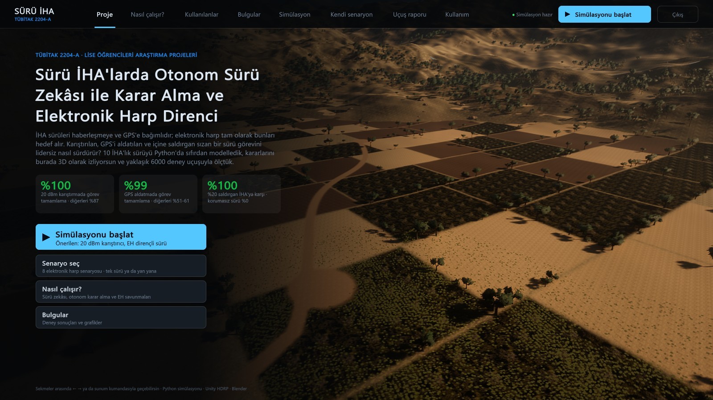

Simülasyon sırasında ekranda:
- **Üstte senaryo kutusu:** bu senaryoda neye bakılması gerektiğini anlatır, sonra küçülür
  ("Ne izlemeliyim?" ile yeniden açılır).
- **Sağda olay akışı:** sürüde olanları canlı anlatır ("İHA-4: GPS karıştırıldı", "Sürü karıştırıcının yerini
  buldu (hata 40 m)", "İHA-3 aldatmayı fark etti"...).
- **Canlı grafikler:** olay akışının altında uçuş boyunca üç çizgi grafik akar: paket iletimi, GPS'siz uçan İHA
  sayısı (GPS'i karıştırılan ya da aldatmayı fark edip GPS'e güvenmeyen) ve görev puanı (yanlarında anlık değer). Karıştırma alanına girilince paket iletiminin düştüğü, sürü
  toparlanınca yükseldiği görülür; grafiğin üstüne gelince o anın değeri okunur. Yan yana uçuşta iki sürü aynı
  grafikte (turuncu solda korumasız, yeşil sağda dirençli). Araç çubuğundaki **Grafikler** ile açılıp kapanır.
- **Sesler:** her İHA'nın pervane uğultusu 3B duyulur: kameraya yaklaşınca artar, uzaklaştıkça hem kısılır hem
  boğuklaşır (havada yol alan sesin tizleri söner). Pervaneler gibi kalkışta hızlanır, tırmanırken biraz incelir, inince
  ya da arızada durur; her İHA'nın devri biraz farklıdır, sürü tek bir ton değil hafif dalgalanan bir uğultu çıkarır.
  Bölgeye göre rüzgâr (karlı dağlarda daha boğuk ve esintili), Kızılırmak'ta kıyıdan gelen su sesi, Akdeniz'de kıyıya vuran dalgalar; olay akışında
  yalnızca önemli anlarda yumuşak bir ton (hedefler tamamlanınca ya da karıştırıcı bulununca iki nota yukarı, GPS
  karıştırılınca ya da arızada iki nota aşağı, görev bitince kısa bir arpej; en az 2,5 saniye arayla). Bütün sesler
  2 kHz'in altında yoğunlaşır, tiz ve sert ses yoktur. Menüdeyken ortam sesleri kısılır. Araç çubuğundaki **Ses** ile açılıp kapanır,
  seviye Simülasyon sekmesinden (Kapalı / Kısık / Normal).
- **Solda bilgi paneli:** uçuş evresi, hedef, puan, süre ve EH durumu.
- **Altta araç çubuğu:** kamera, katmanlar, renklerin anlamı, arıza ve yeni hedef gibi müdahaleler. Her
  düğmenin üstüne gelince ne yaptığı yazar; klavye kısayolu bilmek gerekmez.
- **Karıştırma ısı haritası:** karıştırıcının uçuş yüksekliğindeki (40 m) gücü araziye renkli bir örtü
  olarak serilir. Açık kırmızı zayıf, koyu kırmızı güçlü karıştırmadır; ince soluk çizgide İHA karıştırmayı
  fark eder, kalın parlak çizgide 60 m'deki komşusuyla bağlantısının yarısı kopar. Harita, İHA'ların uçuşta ölçtüğüyle
  aynı fizikle (yol kaybı + arazi gölgesi) Python'da hesaplanır; tepelerin ardındaki açık renkli boşluklar
  arazinin gölgesidir. Sol altta renk skalası durur; "Isı haritası" düğmesiyle açılıp kapanır. Kırmızı kubbe
  düz arazide ne olacağını, ısı haritası gerçekte ne olduğunu gösterir.

  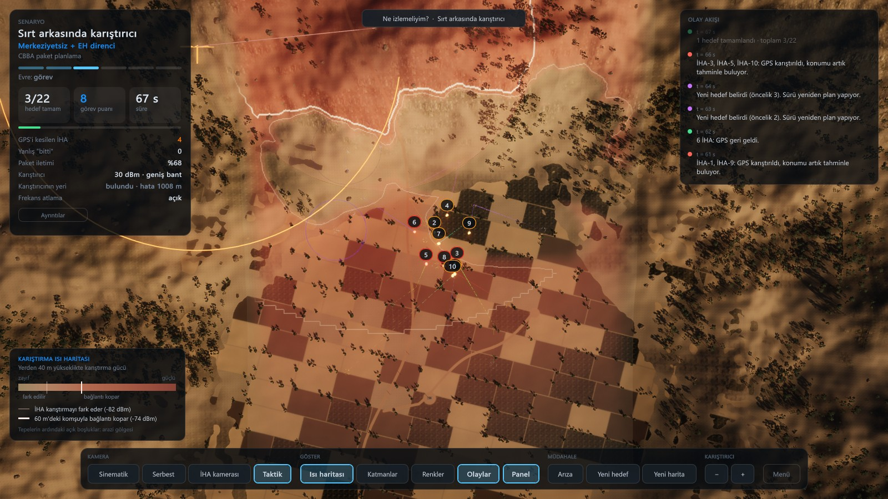
- **Katmanlar paneli:** sahnedeki çizgi ve işaretler ayrı ayrı açılıp kapanır: İHA bağlantıları
  (kapalı / yalnızca sorunlu / hepsi), karıştırma ısı haritası, sürünün karıştırma haritası, İHA planları,
  konum hayaletleri, uçuş izleri, uzak işaretler. Bağlantılar varsayılan olarak kapalıdır (sahne temiz görünsün); "Sorunlu" seçilince
  yalnızca karıştırılan bağlantılar kırmızı çizilir. Seçimler bilgisayarda hatırlanır.

  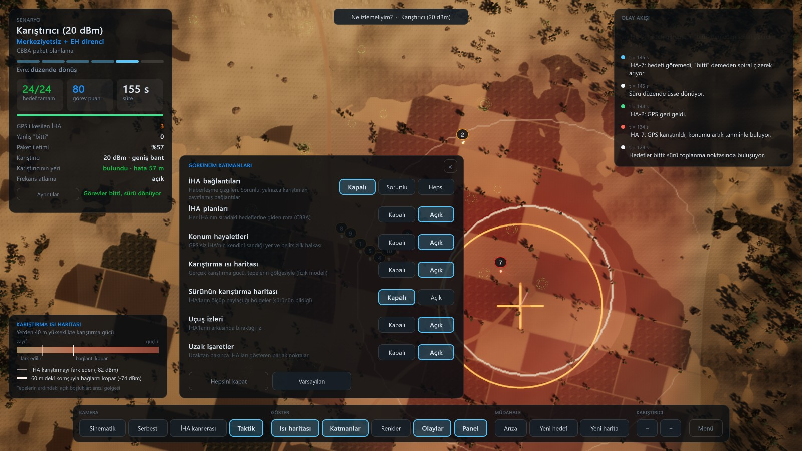
- **İHA kamerası (TPP):** "İHA kamerası" düğmesiyle bir İHA'yı arkasından izlersin. Altta İHA-1 … İHA-10
  seçici çıkar (her düğmenin altındaki çizgi o İHA'nın durum rengi); üstte izlenen İHA'nın kartı durur:
  durumu, evresi, GPS'i, konum belirsizliği, karıştırma seviyesi, hedefi ve planı. Taktik görünümde her
  İHA'nın numarası yazar, numaraya tıklayınca kamera o İHA'ya geçer. Yan yana modunda iki ekran da aynı
  numaralı İHA'yı kendi sürüsünde izler (aşağıda GPS aldatmada İHA-5: solda kandırılmış, sağda fark etmiş).

  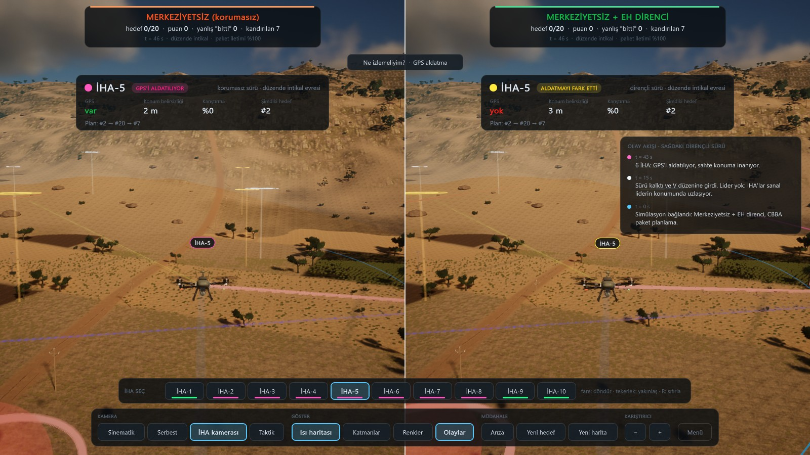
- **Görev sonu ekranı:** tamamlanan hedef, puan, süre, yanlış "bitti" sayısı ve aynı senaryonun
  30 uçuşluk deney ortalamasıyla karşılaştırma. Buradaki **Uçuş raporu** düğmesi rapor sekmesini açar.
- **Uçuş raporu:** sürü inince Python her İHA'nın ne yaptığını gönderir. Solda harita: arazi gölgelemesi,
  karıştırma ısı haritası ve her İHA'nın izi; iz, İHA'nın o anki durum renginde çizilir (yeşil normal, turuncu
  karıştırılıyor, kırmızı GPS yok, mavi spiral arama…), yani GPS'in nerede kesildiği haritada görünür. Hedefler
  (yapılan / yapılamayan), karıştırıcı ve sürünün tahmini de işaretlidir. Sağda özet sayılar, İHA tablosu
  (yaptığı hedef, uçtuğu yol, GPS'siz ve karıştırma altında geçen süre, ne yaptığı: spiral arama, GPS kurtarma,
  röle, arıza, aldatma) ve uçuşun öne çıkanları ("En çok hedefi İHA-5 yaptı", "Sürü karıştırıcının yerini
  31 m hatayla buldu"...) ile "Uçuş boyunca" grafikleri (paket iletimi, GPS'siz uçan İHA, görev puanı). Tablodaki
  bir İHA'nın üstüne gelince izi ve yaptığı hedefler haritada öne çıkar. Yan yana uçuşta iki sürünün raporu ayrı
  ayrı açılır.

  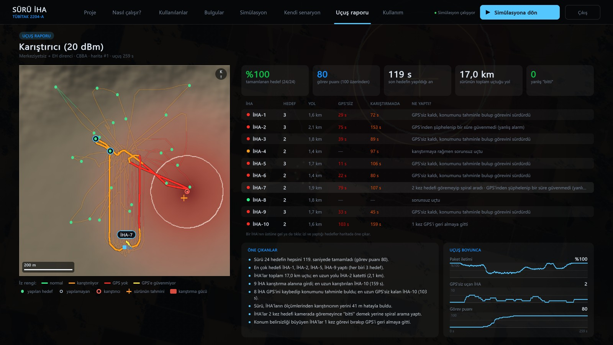
- **Bölgeler:** her senaryo altı haritada uçulabilir (Simülasyon ve Kendi senaryon sekmelerinde **Bölge**). Bölge
  seçilince simülasyon, kamera ve İHA'lar oraya geçer; Python da o bölgenin yükseklik haritasıyla uçar (`--region`):
  tepeler sinyali her bölgede kendi arazisine göre gölgeler, İHA'lar araziyi izleyerek uçar.
  - *Orta Anadolu ovası* (`ova`): tarlalar, bozkır tepeler, köy; deneylerin yapıldığı harita.
  - *Karlı dağlar* (`kar`, ana araziden 12 km doğuda): karla kaplı geniş bir vadi, yamaçlarda karlı çam ormanları,
    çevresi 400-500 m yükselen sarp dağlar. Güneş alçalır, yoğun kar yağar (rüzgârla savrulur), pus artar, renkler soğur.
    Dağlar karla örtülüdür: kaya yalnızca kar tutmayan çok sarp yüzlerde görünür, orada da oluklarda kar şeritleri kalır;
    çamların iğneleri karla örtülüdür, aralarında koyu yeşil kalır. Vadide parlak, mavimsi buzu gökyüzünü yansıtan donmuş bir göl ve çatıları karla
    örtülü bir dağ köyü var; köyün bacalarından ince duman tüter. Isı haritası bembeyaz karın üstünde daha ince çizilir.
  - *Kızılırmak (Sivas)* (`nehir`, 12 km batıda): Sivas platosunda geniş bir vadi; görev alanının ortasından
    kıvrılarak akan kızıl-kahve, alüvyonlu Kızılırmak (akan, parlak su yüzeyi). Kuzey yakada nehre adını veren kızıl
    kil yarlar ve plato, kıyılarda kavak ve söğüt sıraları, çakıllı kum adacıkları, sulu tarlalar, yolun nehri geçtiği
    beton köprü ve kıyıda bir köy. İHA'lar görevde nehrin iki yakası arasında gidip gelir.
  - *Divriği (Sivas)* (`divrigi`, 12 km kuzeyde): Çaltı Çayı vadisine inen yamaçta tarihî kent. Tepede kayalık kale
    (yıkık surlar, yuvarlak ve kare burçlar), yamaçta taraça üstünde **Ulu Camii ve Darüşşifası** (1228-29, UNESCO
    Dünya Mirası), çevresinde cumbalı, taş zeminli Divriği evleri ve bahçeler; vadide kavak sıraları ve meyve bahçeleri,
    kuzeyde demir yüklü kızıl dağlar. Külliye Blender'da, yapının yayımlanmış fotoğraflarına (kaleden kuşbakışı, batı
    cephesi, kapılar, minare) bakılarak kodla kuruldu (ölçüler yaklaşık):
    - 32 x 64 m kesme taş gövde: kuzeyde 40 m'lik cami, güneyde kıble duvarına dayanan iki katlı darüşşifa; sağır
      duvarlarda az ve küçük, demir parmaklıklı pencereler, yağmur iniş boruları.
    - Örtü: alçak eğimli kurşun kaplı kırma çatılar ve ahşap saçaklar, iki ışıklık feneri; mihrap önü kubbesinin ve
      türbenin kare kaideden "Türk üçgenleri"yle sekizgene geçen kesme taş külahları.
    - Kuzey taç kapısı: duvardan yükselen, kendi saçaklı örtüsü olan anıtsal kapı; derin sivri kemerli niş, ızgaralı
      kapı ve üstünde altıgen yıldız, çıkıntılı mukarnaslı saçak, sivri kemer ağızlı hücrelerden mukarnas kavsara,
      başlıklı sütunlar, Divriği'ye özgü yüksek kabartma bitkisel kitleler, madalyonlar, kitabe.
    - Pahlı, dokuma gibi oymalı batı kapısı ve iki yanında basamaklı taş sekiler; darüşşifanın üç kademeli iç içe
      sivri kemerli kapısı (kapı, üstünde pencere, çıkıntılı başlıklar); doğuda Şah kapısı.
    - Kuzeybatı köşesinde yuvarlak payanda (kurşun külahlı) ve arkasından yükselen kare kürsülü silindir minare
      (kademeli şerefe, taş korkuluk, petek, taş külah). Batıda avlu ve külliyeyi taşıyan taş döşeli taraça.
    - Yüzeyler: UV0 dünya ölçekli açılır, taş sıraları her yüzde yatay. Kodla üretilen dokular kullanılır: kesme taş
      (krem, bal, pembemsi ve gri bloklar; derz, kırık kenar, keski izi), iki Selçuklu oyması (sekiz kollu yıldız
      geçmesi, dokuma gibi altı kollu yıldız ağı; paralaks kapatmalı derinlik), kurşun ve avlu döşemesi.
    - Yıpranma: bütün külliye ikinci bir UV atlasında açılır. Blender Cycles ile ekran kartında ortam kapatma,
      konum ve normal pişirilir; zemin nemi, yağmur akıntısı, leke ve toz bunlardan hesaplanır. Sonuç HDRP ayrıntı
      haritası olarak taşı koyulaştırır (niş içleri, saçak altları, duvar dipleri).
  - *Gökpınar Gölü (Gürün)* (`gokpinar`, 12 km güneyde): bozkır platosunun ortasında yerden kaynayan turkuaz karstik
    göl; kıyıda sığ ve açık turkuaz, ortada 17 m'ye inen koyu mavi huni, dibe kadar berrak (HDRP su yüzeyi: dalgacık
    ve dipte kostik ışık oyunları, beyaz kalker dibi). Gölden çıkan dere boyunca kavak ve söğütler, alabalık
    havuzları; kıyıda ahşap kameriyeler ve suyun üstünden geçen yürüyüş iskelesi; batıda kalker sırt, güneydoğuda köy.
  - *Akdeniz kıyısı* (`deniz`, 12 km kuzeydoğuda): kuzeyde açık deniz (HDRP okyanus benzetimi: gerçek dalga ve köpük,
    kıyıdaki sığlıkta turkuaz, açıkta lacivert), ortada kumlu koy ve balıkçı limanı (taş mendirek ve feneri, beton
    iskele, balıkçı tekneleri), iki yanda kalker yalıyarlar, doğu burnunda deniz feneri ve bekçi evi, koyun üstündeki
    yamaçta beyaz badanalı mavi panjurlu kıyı evleri ve zeytinlik, güneyde kızılçam ormanlı tepeler. Görev alanının
    kuzey yarısı denizin üstündedir: Python'a giden haritada deniz yüzeyinin altı deniz yüzeyi sayılır (İHA'lar suyun
    üstünde uçar), hedef işaretleri ve ısı haritası suya oturur. Kıyıya vuran dalgaların sesi duyulur.

  Kar, kızıl toprak ve nehir çakılı dokuları Poly Haven'dan (CC0) fotoğraf taramasıdır.

  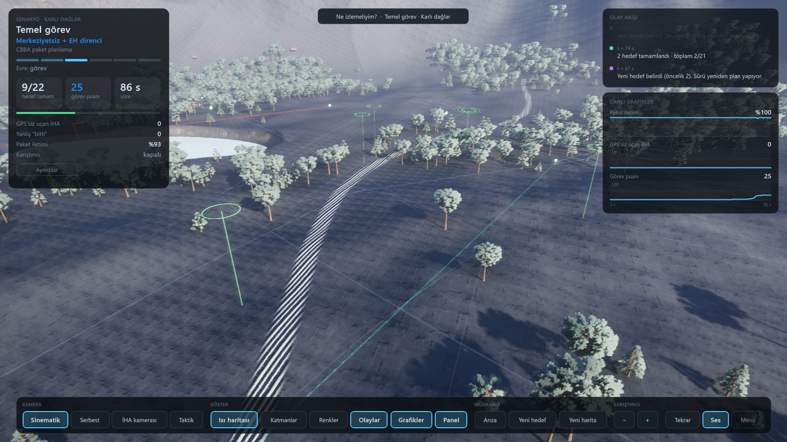

  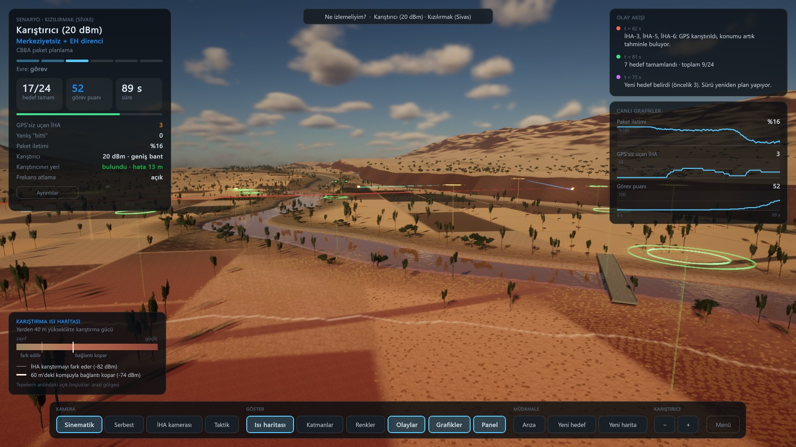

  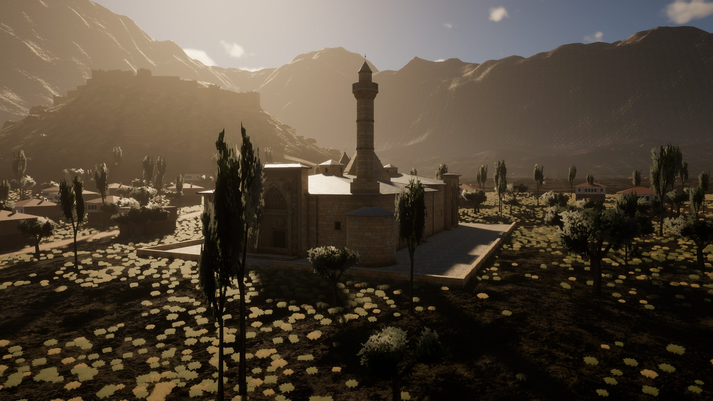

  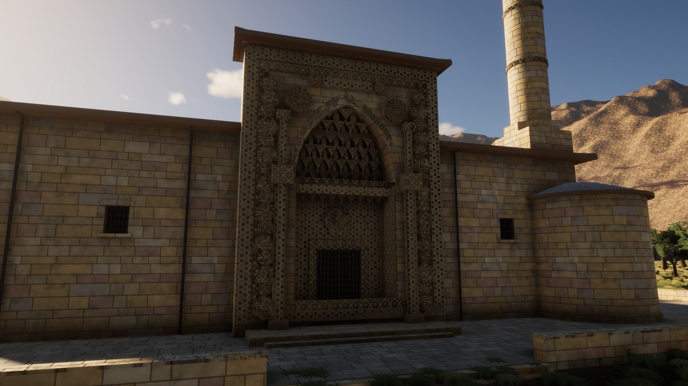

  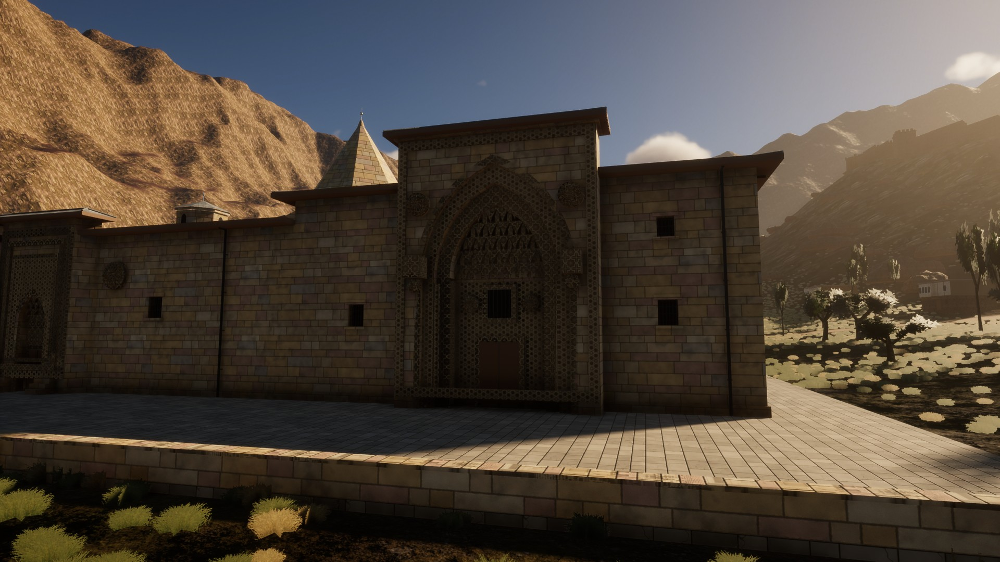

  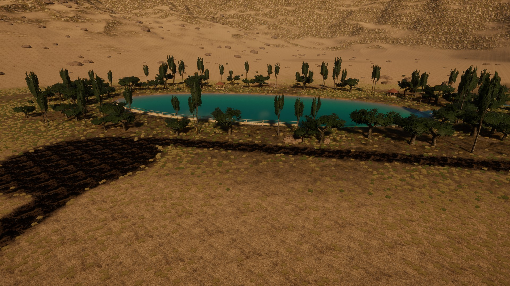

  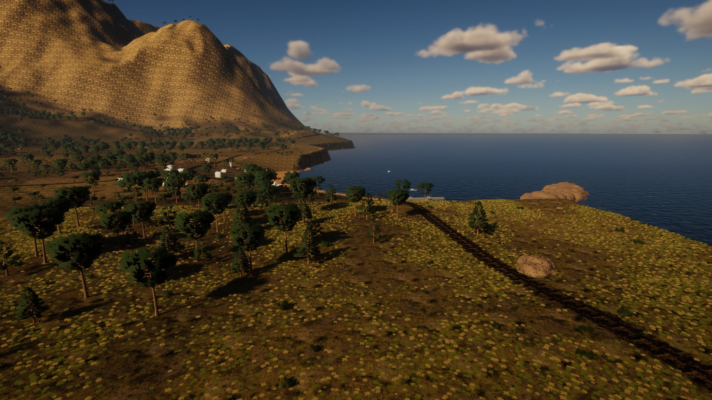
- **Hava savunma radarı** (senaryo "Hava savunma radarı"): görev alanının batısındaki tepede yeri istihbaratla bilinen
  bir radar, kuzeydoğuda 80. saniyede açılan bir pusu radarı; ikisinin yanında dört tüplü füze rampası. Radarın anteni
  döner, kehribar tarama huzmesi görünür; araziye serilen kehribar örtü radarın İHA'yı bir taramada görme olasılığıdır
  (parlak çizgi: yarı yarıya), tepelerin gölgesi örtüde boşluk olarak görünür. Radar bir İHA'yı izlemeye başlayınca
  aralarına kızıl bir kilit çizgisi çekilir, iz 4 saniye korunursa füze kalkar (beyaz duman izi); İHA kaçabilirse füze
  ıskalar, kaçamazsa İHA düşer. Dirençli sürünün planı radarın görmediği yerden kırık çizgilerle geçer; pusu radarı açılınca
  İHA'ların radar ikaz alıcıları onu duyar, sürü yerini birkaç saniyede bulur (pembe çarpı nişangâh, gerçek radara hata
  çizgisi). Olay akışı her anı anlatır: "İHA-4: radar kilitlendi!", "Füze ıskaladı", "Sürü pusu radarının yerini buldu".

  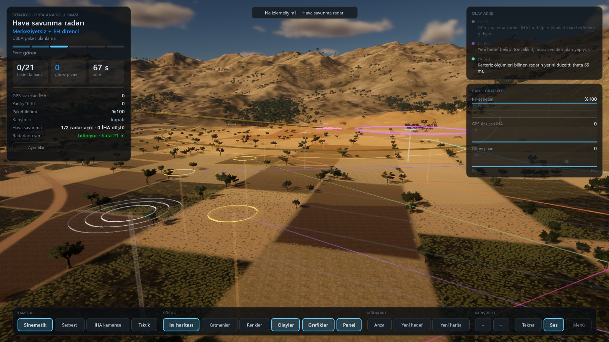

  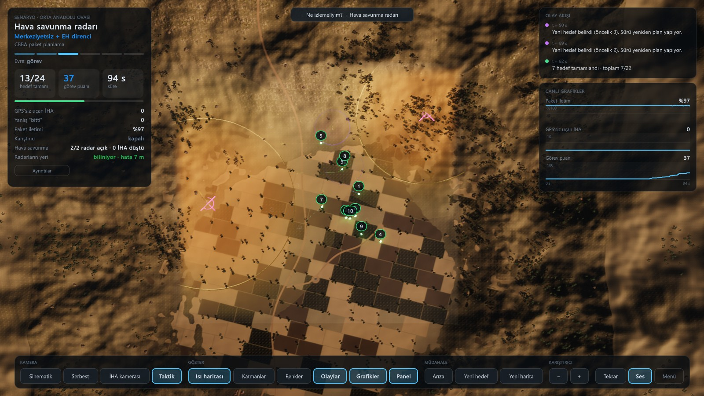

  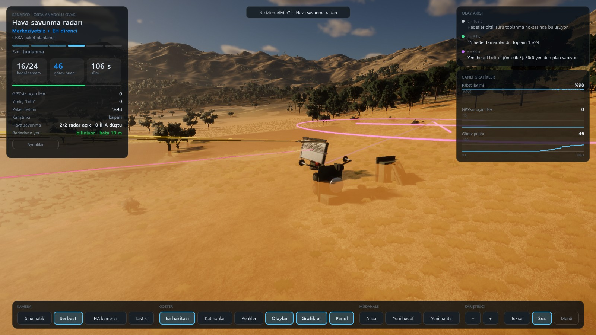

  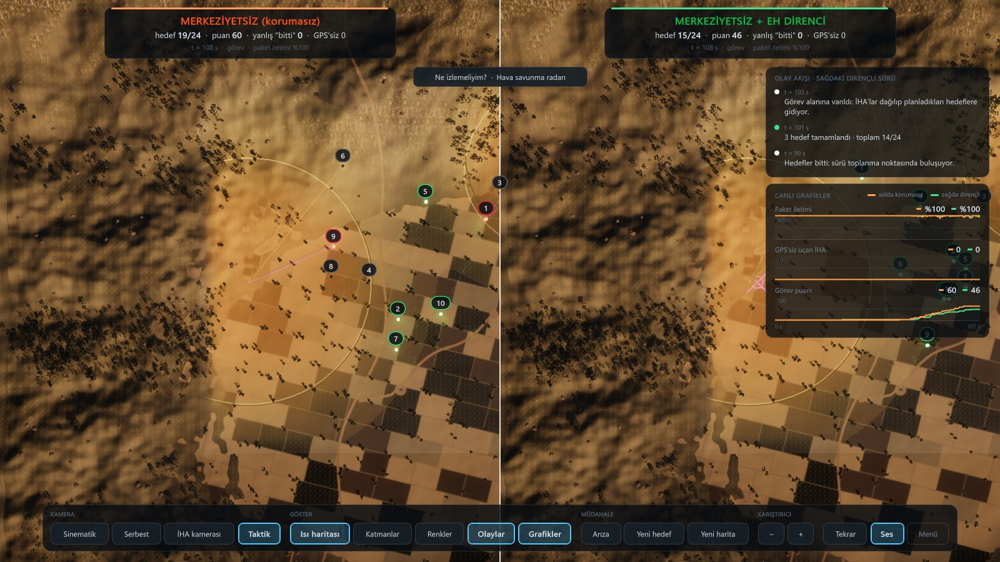
- **Rüzgâr ve batarya** (senaryo "Lodos ve yarı dolu bataryalar"): 8 m/s lodos esiyor, bataryaların bir kısmı %20-35.
  Üsteki kırmızı-beyaz rüzgâr tulumu rüzgârın yönünü ve gücünü gösterir, karlı bölgede kar taneleri rüzgârla savrulur.
  İHA kamerasındaki kartta bataryanın doluluğu ve çekilen güç (W) yazar; beyaz ışıklı İHA bataryası azaldığı için eve
  dönüyordur. Görev sonu ekranı düşen İHA sayısını (hava savunma / batarya) da verir.

  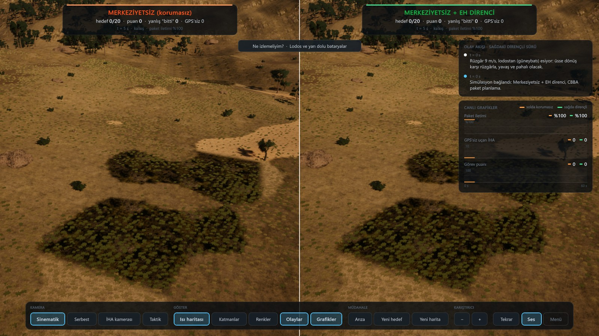
- **Konvoy koruma** (senaryo "Konvoy koruma (İKA)"): üsten çıkan 4 İKA'lık konvoy 721 m'lik bir rotayla düz vadiden hedefe gider;
  yolda iki gizli mayın, yol kenarında kamuflaj ağı altında iki pusu mevzisi, yolun ortasında 20 dBm karıştırıcı ve yolun
  kuzeyini koruyan bir HSS radarı var. Konvoy yalnızca sürünün taradığı yolda ilerler: taranmış yol yeşil, taranmamışı
  soluk çizilir; küçük halkalar yol tarama noktalarıdır. Araçlar araziye oturur, tekerleri döner, arkalarında toz kalkar;
  silah kuleleri bulunan pusuya döner. Sürünün henüz bilmediği tehdit mor, bulunan kırmızı halkayla görünür; bulunan mayına
  ikaz bayrağı dikilir, bulunan pusunun 160 m'lik ateş menzili çizilir. Pusuyu bir İHA lazerle işaretler (kızıl huzme),
  topçu mevziyi vurur (patlama, duman). Radarın şemsiyesi taranacak yolu kesince dirençli sürü **HSS bastırma** yapar:
  karıştırıcı İHA'dan radara mor bir huzme uzanır, yem İHA radara koşar (turuncu), iki kamikaze İHA iki yönden dalar
  (kırmızı); vurulan radar kararır ve tüter. Korumasız sürü karıştırmada konumunu yanlış bildiği için bazı yol parçalarını
  taramadan "temiz" sayar: konvoy gizli mayına basar ya da pusuya yürür; vurulan araç patlar, kararır ve tüter. Görev
  kartında konvoyun aldığı yol ve sağlam araç sayısı, olay akışında her an ("İHA kamerası yolun üstünde gömülü bir mayın
  gördü", "Saldırı! … yem radara koşuyor", "HSS radarı kamikaze İHA'yla imha edildi") yazar.

  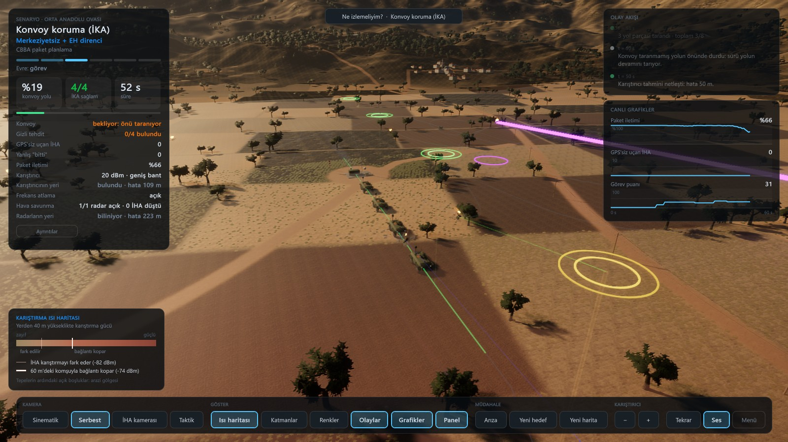

  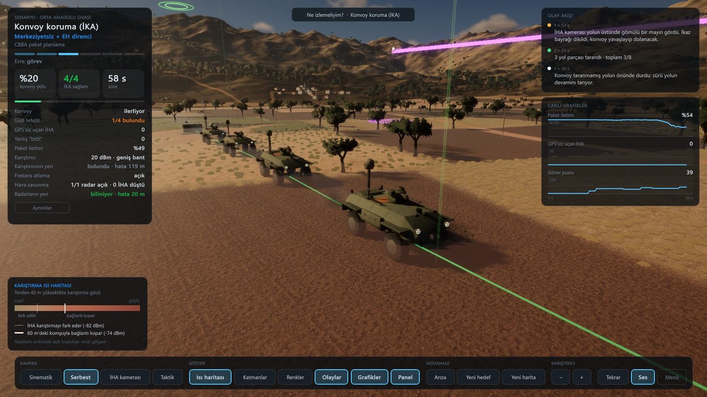

  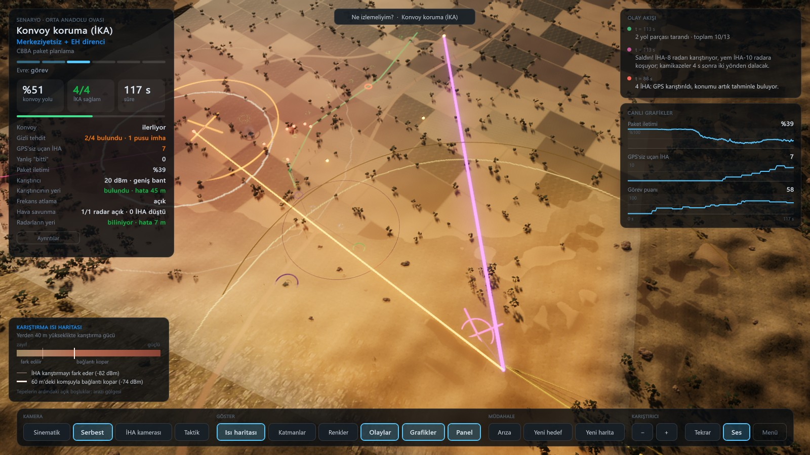

  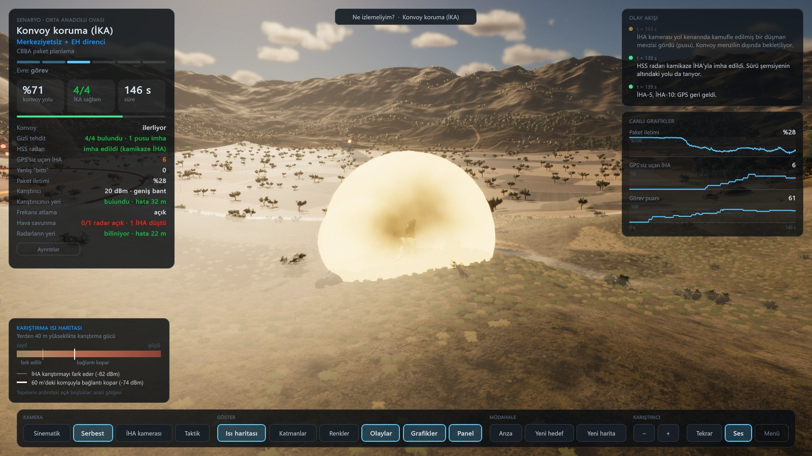

  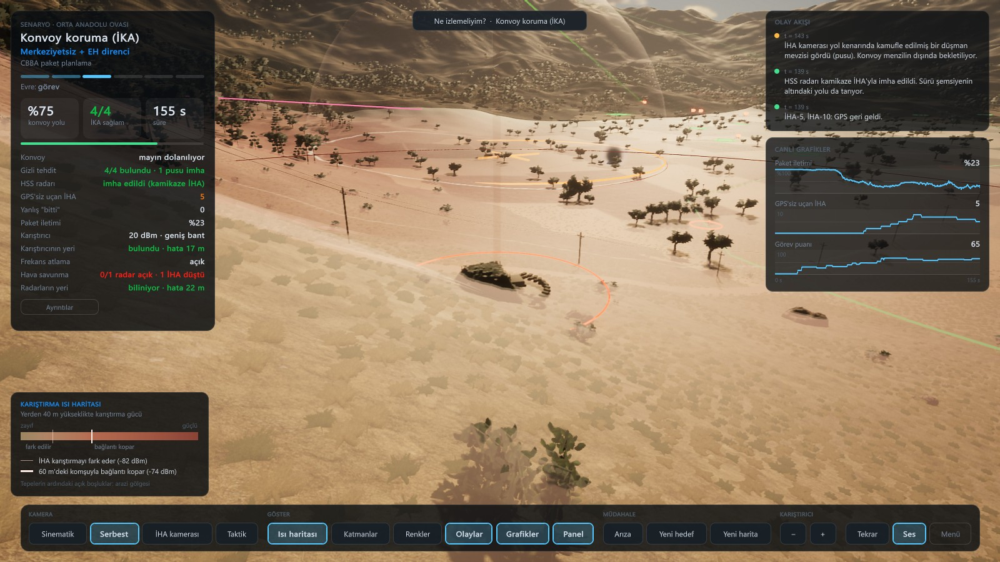

  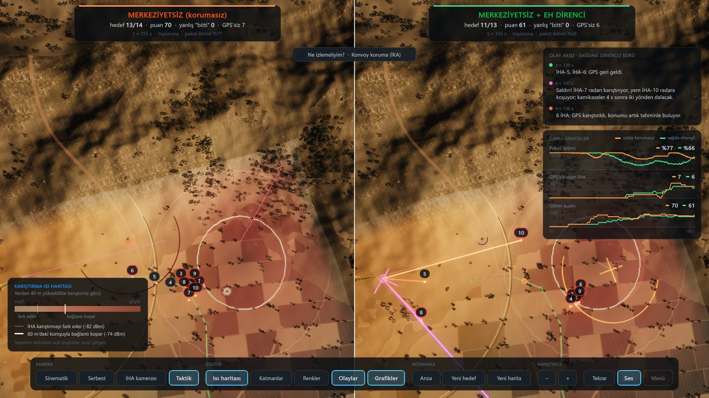
- **Uçuş tekrarı:** araç çubuğundaki **Tekrar** ya da görev sonu ekranındaki **Tekrar izle** uçuşu baştan oynatır. Alttaki
  zaman çubuğuna tıklayıp sürükleyerek istenen ana gidilir, oynatma durdurulur, 1×, 3×, 6× ya da 12× hızla izlenir
  (yeşil çizgi görevlerin bittiği an). Tekrar sırasında canlı simülasyon arkada bekler; **Canlıya dön** kaldığı yere döner.
  Yan yana uçuşta iki sürü aynı saniyede birlikte oynar. Jüriye "şu an ne oldu?" diye geri sarıp göstermek için.

  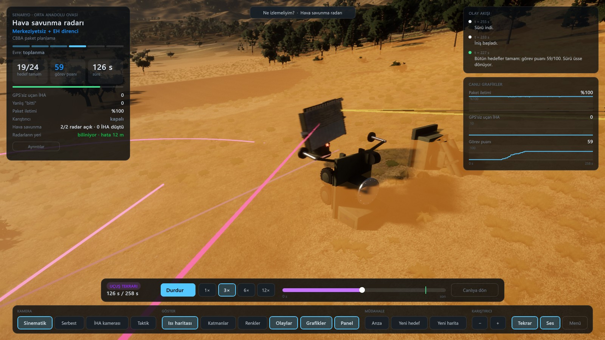
- **Kendi senaryon:** haritaya tıklayarak en fazla 3 karıştırıcı, bir GPS aldatıcı ve en fazla 2 hava savunma radarı
  konur (aynı yere tekrar tıklayınca kalkar; radarlar baştan açıktır, yerleri sürüce bilinmez). Haritada karıştırıcının düz arazide bağlantıyı kopardığı ve GPS'i kestiği alan, aldatıcının
  250 m'lik alanı görünür. Yanında karıştırıcı gücü (10/20/30 dBm) ve türü (geniş bant / nokta), aldatma hızı,
  İHA sayısı (6-12), hedef sayısı, görevde beliren yeni hedef, arızalanan İHA, saldırgan İHA (saf / sinsi), rüzgâr ve
  batarya (sakin / lodos / lodos + yarı dolu bataryalar), karar mimarisi, görev paylaşımı, tek sürü ya da yan yana ve
  hız seçilir. Seçimler bilgisayarda hatırlanır; jüri
  "şunu deneyin" dediğinde yerinde senaryo kurulup gösterilebilir.

  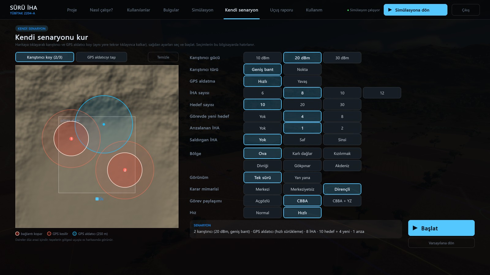

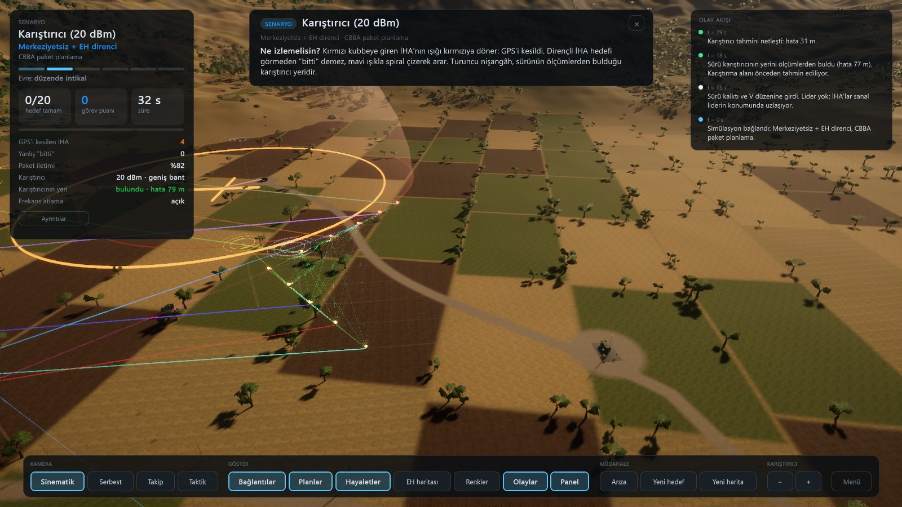

**Esc** artık uygulamayı kapatmaz, menüyü açar (yanlışlıkla kapanmasın diye). Çıkış menüden ve onayla yapılır.

Uygulama simülasyonun yerini, derlemede yanına yazılan `simulasyon_yolu.txt` dosyasından okur
(`tools/full_build.ps1` yazar). Uygulamayı başka bir bilgisayara taşırsan bu dosyadaki yolu düzelt.
Arayüzü otomatik denemek için: `powershell -File tools/ui_test.ps1` (bütün ekranları gezip görüntü alır).

Uygulama arka planda da çalışmaya devam eder, yani başka pencereye geçince donmaz.

**Bir uçuşta ne görürsün:** Sürü üsten kalkar ve havada halka olur. V düzeninde kuzeydeki görev
alanına uçar. Daha yoldayken her İHA'nın planı (renkli çizgi: İHA → 1. hedef → 2. hedef → 3. hedef)
belirir. Alana varınca dağılıp planlarını uygular. Görev sırasında yeni hedefler belirir (mor dalga).
Sürü bunları birkaç saniyede kendi arasında yeniden paylaşır. Görevler bitince toplanma noktasında
yeniden halka olur, V düzeninde üsse döner ve iner. Toplam yaklaşık 3,5 dakika sürer.

**Sunum ipucu:** Simülasyon bir kez başladıktan sonra her şeyi Unity'den yönetebilirsin.
F1/F2/F3 ile mimariyi, F4 ile planlama algoritmasını, +/- ile karıştırıcıyı, X ile saldırganı değiştir.
V ile düzeni değiştir. Z ile bir İHA'yı düşür ve planların nasıl yeniden dağıldığını göster. Y ile görev
alanına yeni bir hedef ekle ve sürünün kendi kendine kimin gideceğine karar vermesini izlet.
Aynı haritada mimarilerin ve algoritmaların farkını jüriye canlı gösterebilirsin. Sürü inince
simülasyon bekler, N ile yeni harita başlar.

**Performans:** RTX 4060 dizüstünde ölçüldü (sinematik kamera): Yüksek kalitede ~45 FPS (hacimsel sis, bulut gölgeleri, hareket bulanıklığı açık), Dengeli kalitede ~73 FPS. GPU ısınınca biraz düşer; bellek sabit, sızıntı yok. Sunumdan önce bilgisayarı prize tak, takılma olursa K ile Dengeli'ye geç.

### Canlı simülasyon seçenekleri

| Komut | Ne yapar |
|---|---|
| `python run_live.py` | Dirençli sürü, 20 dBm karıştırıcı |
| `python run_live.py --strategy centralized --jammer 30` | Merkezi mimari, güçlü karıştırma |
| `python run_live.py --strategy decentralized --spoof 0.2` | Saldırgan İHA'lı senaryo |
| `python run_live.py --jammer off --speed 3 --loop` | Karıştırıcısız, 3x hızlı, sürekli tekrar |
| `python run_live.py --formation hat --failures 2` | Hat düzeninde intikal, görevde 2 İHA arızası |
| `python run_live.py --strategy decentralized --relay` | Bağlantı koruma rölesi açık |
| `python run_live.py --planner greedy` | Eski yöntem: her İHA en yakın tek görevi alır (karşılaştırma için) |
| `python run_live.py --planner ai --jammer 30` | CBBA + yapay zekâ, güçlü karıştırma |
| `python run_live.py --popups 0` | Görev sırasında yeni hedef belirmesin (varsayılan 4) |
| `python run_live.py --jammer-mode hareketli` | Karıştırıcı araç görev alanının çevresinde devriye gezer (ayrıca: `iki`, `nokta`, `tepe`, `sirt`) |
| `python run_live.py --jammer off --gps-spoof hizli` | GPS aldatıcı (İHA'ların konumunu 2 m/s sürükler; `yavas` 0,5 m/s) |
| `python run_live.py --jammer off --spoof 0.2 --spoof-mode sneaky` | Sinsi saldırgan İHA'lar |
| `python run_live.py --jammer 20 --jammers=-150,300;200,500` | Kendi senaryon: karıştırıcıları verilen noktalara koy (`--jammer-band nokta` ile nokta karıştırıcı) |
| `python run_live.py --jammer off --gps-spoof hizli --spoofer=100,400` | GPS aldatıcıyı verilen noktaya koy |
| `python run_live.py --drones 8 --tasks 10 --failures 1` | İHA, hedef ve arıza sayısı (`run_compare.py` de kabul eder) |
| `python run_live.py --jammer off --radar iki` | Hava savunma: yeri bilinen radar + 80. saniyede açılan pusu radarı (`bilinen`, `pusu` tek başına) |
| `python run_live.py --jammer off --radars=-300,650;500,200` | Kendi senaryon: radarları verilen noktalara koy (baştan açık, yerleri bilinmez) |
| `python run_live.py --jammer off --wind 8 --battery karisik` | 8 m/s lodos, bataryaların bir kısmı %20-35 (`--wind-from` derece, `--battery dusuk`) |
| `python run_live.py --convoy` | Konvoy koruma: 4 İKA, gizli mayın ve pusu, yolu koruyan HSS radarı, yolun ortasında 20 dBm karıştırıcı (`run_compare.py --convoy` yan yana) |
| `python run_live.py --region kar` | Karlı dağlar bölgesinde uç (`nehir`: Kızılırmak, `divrigi`: Divriği, `gokpinar`: Gökpınar Gölü, `deniz`: Akdeniz kıyısı; varsayılan `ova`: Orta Anadolu ovası; `run_compare.py` de kabul eder) |

### Yan yana karşılaştırma (sunum için)

`run_compare.py` aynı haritada, aynı saldırı altında iki sürüyü birlikte uçurur. Unity ekranı kendiliğinden
ikiye böler: solda korumasız sürü, sağda EH dirençli sürü. İki kamera aynı açıdan bakar; her yarı yalnızca
kendi sürüsünü gösterir, arazi ortaktır. Üstteki paneller görev sayısını, puanı ve yanlış "bitti" sayısını
canlı karşılaştırır.

| Komut | Ne gösterir |
|---|---|
| `python run_compare.py` | 20 dBm sabit karıştırıcı |
| `python run_compare.py --jammer off --gps-spoof hizli` | GPS aldatma: solda İHA'lar pembe (kandırıldı), sağda sarı (fark etti) |
| `python run_compare.py --jammer-mode iki` | İki karıştırıcı (en büyük fark: %39'a karşı %99,5) |
| `python run_compare.py --jammer off --spoof 0.2 --spoof-mode sneaky` | Sinsi saldırgan İHA'lar |
| `python run_compare.py --left centralized` | Solda merkezi mimari |

Kısayollar canlı moddakiyle aynıdır. **Z** (arıza) iki tarafta aynı İHA'yı düşürür, **Y** (yeni hedef) iki
tarafta aynı yerde belirir; böylece karşılaştırma adil kalır. Sol sürü UDP 5065'ten, sağ sürü 5067'den gelir.

### Tanıtım videosu

Video tamamen bu depodaki araçlarla üretilir; ek program indirmek gerekmez (kodlama Blender'ın içindeki
FFmpeg ile yapılır).

```
.venv\Scripts\python.exe tools\record_film.py          # 1) uçuşları kaydeder, çekim senaryosu ve kartları yazar
powershell -File tools\render_film.ps1                 # 2) Unity kareleri çeker, 3) Blender MP4 yapar
```

1. `record_film.py` üç uçuşu kare kare kaydeder (dirençli sürü 20 dBm; GPS aldatma ve iki karıştırıcı
   için yan yana çiftler). Alana varış, yeni hedef, GPS kaybı, spiral arama, karıştırıcının bulunması ve
   dönüş anlarını kayıttan kendisi bulur ve çekimleri bunlara göre kurar. Sonuç kartlarını
   `results/*.csv` verisinden çizer. Yalnızca kurgu değiştiyse `--reuse` yeniden uçurmadan çalışır.
2. `SuruIHA.exe -suruFilm C:\SuruIHA\film\film.json` kayıtları oynatır ve her kareyi JPG olarak yazar. Oyun
   zamanı sabit adımlıdır, bu yüzden bilgisayar yavaş da olsa video akıcıdır.
3. `tools/make_video.py` (Blender arka planda) kartları, kareleri, alt yazıları ve yan yana etiketlerini
   birleştirip `sunum/tanitim_videosu.mp4` dosyasını yazar (1920×1080, 30 kare/s, H.264, ~2 dk).

Her video karesi 0,1 s simülasyondur; video 3 kat hızlıdır ve bu ekranda yazar. MP4 git'e girmez.

### Unity kısayolları

| Tuş | İşlev |
|---|---|
| **C** | Sinematik kamera (açılışta bu) |
| **O** | Serbest kamera: fare ile döndür, tekerlekle yakınlaş, WASD/QE ile kaydır, Shift hızlı |
| **F**, **Tab**, **1-9**, **0** | İHA kamerası (üçüncü şahıs, TPP): seçili İHA'yı arkasından ve üstünden izler. 1-9 ve 0 (İHA-10) doğrudan seçer, Tab sıradakine geçer. Fareyle sürükleyince İHA'nın etrafında döner, tekerlekle yakınlaşır |
| **R** | İHA kamerasının açısını ve uzaklığını sıfırla |
| **T** | Taktik kuşbakışı |
| **L** | İHA bağlantıları: kapalı → yalnızca sorunlu (karıştırılan) → hepsi |
| **G** | "İHA'nın sandığı konum" hayaletlerini göster/gizle |
| **J** | Dirençli sürünün ortak karıştırma haritası |
| **B** | Uzaktan görünen İHA işaretleri (durum renginde parlayan noktalar) |
| **P** | İHA'ların planlı rotalarını göster/gizle |
| **F1 / F2 / F3** | Senaryo: merkezi / merkeziyetsiz / dirençli mimari (Python'u yeniden başlatmadan) |
| **F4** | Planlama algoritması: açgözlü tek görev → CBBA → CBBA + yapay zekâ |
| **Y** | Görev alanına yeni bir hedef ekle (en fazla 8; yer istasyonu ihbarı gibi) |
| **+ / -** | Karıştırıcı gücü: kapalı → 10 → 20 → 30 dBm |
| **M** | Karıştırıcı türü: sabit → hareketli → iki → nokta (FHSS testi) → tepede → sırt arkasında |
| **U** | GPS aldatıcı: yok → hızlı → yavaş |
| **X** | Saldırgan İHA'lar (%20): yok → saf → sinsi |
| **N** | Yeni harita (farklı görev noktaları) |
| **V** | Düzen tipi: V → hat → kol → halka (uçuşu yeniden başlatmadan) |
| **Z** | Rastgele bir İHA'yı arızalandır (düşer, sürü görevlerini ve düzeni yeniden dağıtır) |
| **K** | Grafik kalitesi: Yüksek → Dengeli → Performans (paneldeki "Ayrıntılar"da FPS görünür) |
| **I** | Renklerin anlamı (İHA ışıkları, hedef halkaları, EH işaretleri) |
| **Esc** | Menü: devam et, senaryo değiştir, proje bilgisi, ana ekran, çıkış |
| **← → / PageUp PageDown** | Menüde sekme değiştir (sunum kumandası da çalışır) |
| **H** | Bilgi panelini gizle |

**Renkler:** İHA ışığı yeşil = normal, turuncu = karıştırılıyor, kırmızı = GPS yok, mavi = spiral
arama yapıyor, mor = saldırgan, camgöbeği = röle (koruduğu arkadaşına çizgiyle bağlı), sönük = arızalı. Bağlantı çizgisi yeşilden kırmızıya sinyal kalitesini gösterir.
Görev halkası beyaz = açık, sarı = bir İHA yolda, yeşil = tamamlandı, kırmızı = yanlış tamamlandı,
yanıp sönen mor = yeni belirdi ama sürü henüz bilmiyor. İç içe halka sayısı görevin önceliğidir (1-3).
Renkli çizgiler her İHA'nın planıdır: ilk hedefe giden kısım kalın, sonrakiler ince.
Pembe İHA = GPS'i aldatılıyor (henüz fark etmedi), sarı = aldatmayı fark etti. Kırmızı kubbe = geniş bant,
kehribar = nokta karıştırıcı, camgöbeği kubbe = GPS aldatıcı. Turuncu nişangâh, sürünün karıştırıcının
yeri için tahminidir; beyaz çizgi tahmin ile gerçek karıştırıcı arasındaki hatayı gösterir.

---

## 2. Bilimsel model

### Radyo ve elektronik harp (`suru/radio.py`)
- 2.4 GHz, log-mesafe yol kaybı: `PL(d) = 40 + 10·2.5·log10(d)` dB
- Her bağlantı için **SINR** = sinyal − (gürültü + karıştırma); paket kaybı olasılığı lojistik eğri:
  `PER = 1 / (1 + e^(0.8·(SINR − 10)))`
- Karıştırıcı gücü her alıcıda mesafeye göre hesaplanır. İrtifa ve mesafe gerçekten önemlidir.
- **GPS karıştırma:** Alınan karıştırma gücü −80 dBm'yi aşarsa GPS kesilir. İHA IMU ile ölü hesap
  yapar, hata rastgele yürüyüşle `σ² = σ0² + q²t³/3` şeklinde büyür.
- **Sahte bilgi (spoofing):** Ele geçirilmiş İHA'lar sahte görev teklifi yayar (merkezi mimaride
  istasyona sahte "tamamlandı" raporu gönderir).

### Karşılaştırılan üç karar alma mimarisi (`suru/world.py`)
1. **Merkezi:** Görevleri yer istasyonu dağıtır (SGA). İHA'lar yalnızca istasyonla konuşur.
2. **Merkeziyetsiz:** İHA'lar komşularıyla dedikodu (gossip) protokolüyle konuşur, görevleri
   **CBBA** ile kendi aralarında paylaşır. Lider yok.
3. **Merkeziyetsiz + EH direnci** (projenin özgün katkısı):
   - karıştırmayı algılama ve **ortak karıştırma haritası**
   - karıştırma bölgesindeki arkadaşın sessizliğini "kayıp" değil "meşgul" sayma (uzun TTL)
   - karıştırma bölgesinden transit geçmeme, oradaki görevleri sona bırakma
   - GPS'i olmayan İHA'nın GPS'li komşulardan **işbirlikçi konum düzeltmesi**
   - konum belirsizliği büyükse hedefte **spiral arama** (kamera 15 m'den tanır, görsel güdümle
     üstüne gelir), bulamazsa "bitti" demeyip yeniden deneme
   - **GPS kurtarma:** konum belirsizliği 25 m'yi aşan İHA görevini bırakıp son GPS aldığı noktaya
     döner, konumu düzelince geri gelir (her yer karıştırılıyorsa denemez)
   - konum belirsizliğinin zaman maliyetini (beklenen arama süresi) tekliflere katma
   - **güven sistemi**: makullük kontrolü + itibar (sinsi saldırgana karşı, aşağıda)
   - **karıştırıcıyı bulma**, **frekans atlama (FHSS)**, **GPS aldatma tespiti** (aşağıda)
   - **hava savunmaya karşı:** radar ikaz alıcısı, kerteriz kestirimiyle radarı bulma, radarın görmediği rota, kilit
     ikazında kaçış, şemsiyenin tam altındaki hedefi bırakma (aşağıda)
   - **enerji farkında karar:** rüzgâra karşı eve dönüş enerjisini hesaplayıp görev seçme ve zamanında dönme (aşağıda)

   Her mekanizma ayrı bir ayarla kapatılabilir (`ew_jam_map`, `ew_trust`, `ew_radar`, `ew_energy`...); ablasyon deneyi bunlarla yapılır.

### Elektronik harp (`suru/ew.py`, `suru/radio.py`)
- **Arazi gölgesi:** Tepeler radyo sinyalini keser. Verici ile alıcı arasındaki görüş hattını en çok
  kesen tepe bulunur ve ITU-R P.526 tek bıçak sırtı kırınım kaybı eklenir:
  `v = h·√(2d/(λ·d1·d2))`, `J(v) = 6,9 + 20·log10(√((v−0,1)²+1) + v − 0,1)` dB. Hat tepeyi rahatça
  aşıyorsa kayıp 0, tepe hattı tam kesiyorsa ~6 dB, arkasında kalınmışsa 15-30 dB. Hem İHA'lar
  arası, hem yer istasyonu, hem de karıştırıcı sinyaline uygulanır.
- **Karıştırıcı türleri:** *Geniş bant* bütün 2,4 GHz bandına ve GPS'e gürültü basar. *Nokta*
  karıştırıcı gücünü haberleşme kanalına yığar: kanalda 6,2 dB daha güçlüdür, GPS'e dokunmaz.
  Karıştırıcı **hareket edebilir** (araç görev alanının çevresinde 5 m/s ile devriye gezer), **birden
  fazla** olabilir, **tepeye** (her yeri yukarıdan görür) ya da **sırtın arkasına** (tepeler sinyalinin
  bir kısmını keser) konabilir. Dirençli sürünün karıştırma haritası zaman damgalıdır;
  hareketli karıştırıcının eski konumu 90 s içinde unutulur.
- **Isı haritası (görselleştirme):** `radio.jam_field_dbm` görev alanını 10 m aralıklı bir ızgaraya böler ve
  her noktada, yerden 40 m yükseklikte haberleşme kanalına düşen karıştırma gücünü İHA'larla aynı modelle
  (yol kaybı + bıçak sırtı kırınımı) hesaplar. Harita bayta sıkıştırılıp (0,25 dB adım) Unity'ye yalnızca
  değişince gider; hareketli karıştırıcıda karıştırıcı bir ızgara aralığı yol aldıkça yenilenir. Çizgiler:
  fark etme eşiği (−82 dBm) ve 60 m'lik bağlantının paketlerinin yarısını kaybettiği güç (`radio.jam_tolerance_dbm`).
- **Frekans atlama (FHSS):** Dirençli sürü haberleşme frekansını sürekli değiştirir. Nokta karıştırıcı
  paketlerin yalnızca %24'üne (20/83,5 MHz) denk gelir. Geniş bant karıştırıcıya karşı ise işe yaramaz;
  bu klasik sonuç simülasyonda da görülür.
- **Karıştırıcıyı bulma:** Her dirençli İHA saniyede bir ölçtüğü karıştırma gücünü (konum, dBm)
  kaydeder; ölçümler dedikoduyla yayılır. Model `ölçülen = P − PL(mesafe)`. Her aday konum için en
  iyi güç kapalı formda bulunur (en küçük kareler), en iyi aday kaba → ince ızgarayla aranır. Tek
  kaynak modeli şüpheliyse iki kaynaklı model denenir: en güçlü ölçümler k-ortalamalarla iki kümeye
  ayrılır, kaynaklar dönüşümlü ve yeniden ağırlıklandırılmış en küçük karelerle aranır. Bulunan
  karıştırıcıdan karıştırma alanı **önceden kestirilir**: sürü henüz girmediği karıştırılan hücreleri
  de bilir ve GPS kurtarmada en yakın güvenli kenara gider. Konumundan emin olmayan İHA ölçüm
  kaydetmez. Karıştırıcının en fazla 2 W olduğu kabul edilir; bu, "uzakta tek bir aşırı güçlü kaynak"
  gibi yanıltıcı çözümleri engeller.
- **GPS aldatma:** Yerdeki aldatıcı, 250 m içine giren İHA'nın GPS alıcısını sahte sinyalle ele
  geçirir ve bildirdiği konumu doğuya doğru sürükler (hızlı: 2 m/s, yavaş: 0,5 m/s). İHA "GPS
  sağlam" sanır ve hedefe vardığını zanneder. Dirençli sürünün tespit yolları:
  1. **IMU tutarlılığı:** Son 10 s'de GPS'in söylediği yer değiştirme, IMU'nun ölçtüğünden 5σ'dan fazla
     sapıyorsa GPS'e güvenilmez (hızlı sürükleme ~8 s'de yakalanır).
  2. **Komşu menzili:** İHA'lar birbirine uzaklığı telsizle ölçer (±1 m). GPS konumlarından hesaplanan
     uzaklıklar komşuların çoğunda tutmuyorsa GPS sahtedir.
  3. **"Hedef yok" çıkarımı:** GPS'i sağlamken hedefin üstüne geldiği hâlde aramada da bulamayan İHA,
     konumunun yanlış olduğunu anlar. Yavaş sürükleme genellikle böyle yakalanır.

  Aldatmayı fark eden İHA IMU ile devam eder, belirsizliğini büyütür, aldatma bölgesinden çıkar.
  GPS hem IMU hem komşularla 10 s tutarlı olunca yeniden güvenir.
- **Sinsi saldırgan ve güven sistemi:** Saf saldırgan her görevi "ben oradayım" diye ister ve kolay
  yakalanır. Sinsi saldırgan daha kurnazdır:
  - en fazla 2 görevi konumuyla tutarlı (makul) tekliflerle kilitler ama oraya gitmez,
  - her 10 s'de bir açık bir görevi "tamamladım" diye yayar ve o an kendini hedefin üstünde gösterir.

  Dirençli İHA'lar her komşu için bir **itibar** (Beta dağılımı) tutar ve üç tür kanıt toplar:
  - **menzil:** komşunun bildirdiği konum, telsizle ölçülen uzaklıkla tutuyor mu?
  - **hız:** bildirdiği konum uçamayacağı kadar mı sıçradı?
  - **ilerleme:** "gidiyorum" dediği hedefe 30 s'dir yaklaşmıyor mu?

  Kendi konumu bozuk olan İHA herkesi suçlamasın diye, bir komşu ancak diğerlerine göre aykırıysa
  suçlanır. İtibarı düşen İHA dışlanır. Güvenilen **en az iki ayrı** arkadaşın dışladığı İHA da
  dışlanır (iki bağımsız tanık: tek bir yalancı kimseyi karalayamaz). "Tamamlandı" bilgisi ilk
  bildireni (kaynağı) ile yayılır. Bir İHA dışlanınca onun bildirdiği "tamamlandı"lar geri alınır ve
  görev yeniden açılır.
- **Öngörülü çarpışma önleme:** Her İHA çifti için en yakın yaklaşma noktası (CPA) hesaplanır. 5 s
  içinde 10 m'den yakına gelecekler varsa biri yükselir, öbürü alçalır ve yana açılırlar. (Kafa kafaya
  24 m/s yaklaşan iki İHA, 10 m kala fark etse ivme sınırı yüzünden kaçamaz.)

### Hava savunma tehdidi (`suru/threat.py`)
- **Radar:** X bandı (9,4 GHz), anteni 2 s'de bir tur atan arama radarı. Radar denklemine göre yankı mesafenin 4. kuvvetiyle
  zayıflar: `SNR = SNR50 · (R50 / R)^4 · 10^(−2L/10)`. `R50` küçük bir İHA'nın taramaların yarısında görüldüğü menzildir
  (bilinen radar 380 m, seyyar pusu radarı 300 m). `L` arazinin görüş hattını kesmesinden doğan kayıptır (ITU-R P.526 bıçak
  sırtı kırınımı, X bandında; dalga boyu 3,2 cm olduğundan tepenin arkası neredeyse tam gölge). Yankı iki kez yol aldığı
  için kayıp ikiyle çarpılır. Tek taramada tespit olasılığı Swerling-1 hedef için `Pd = Pfa^(1/(1+SNR))`, `Pfa = 10⁻⁶`.
  Doppler süzgeci radara göre 3 m/s'den yavaş yaklaşan ya da uzaklaşan hedefi 4 kat zayıflatır (radara dik uçmak izi koparabilir).
- **İzleme ve angajman:** son 3 taramanın 2'sinde görülen İHA izlenir. İz 4 s korunursa füze atılır (radar başına 6 füze,
  iki atış arası 6 s). Füze 180 m/s ile hedefin önünü kestirerek güdülür; radar izi koparsa güdümsüz kalır. Yakınlık tapası
  8 m'de patlar, düşürme olasılığı 0,85.
- **Radar ikaz alıcısı (RWR):** huzme İHA'nın üstünden geçince sinyal tek yönlü yol aldığı için radarın kendi menzilinin
  çok ötesinden (1,5 km) duyulur. İHA geliş yönünü (kerteriz, ±3°) ölçer; radarı imzasından tanır, izlenince "kilit ikazı" verir.
- **Kerteriz kestirimi:** ölçümler dedikoduyla yayılır. Sürü, ölçülen kerterizlerle aday konumdan görülecek kerterizlerin
  açı farklarının karelerini en küçük yapan noktayı arar (en çok olabilirlik; kaba ve ince ızgara). Hata Fisher bilgisinden
  hesaplanır: ölçüm noktaları birbirine yakınsa (kerteriz çizgileri neredeyse paralel) uzaklık belirsiz kalır, kestirim
  reddedilir. Pusu radarı açıldıktan ortalama 4 s sonra ~33 m hatayla bulunur.
- **Tehdit farkında rota:** bilinen radarların görüşü 20 m'lik ızgaraya çıkarılır (alçak uçuş yüksekliğinde Pd). Izgara
  bir çizgedir; kenar maliyeti `uzunluk · (1 + 40 · Pd)`. Hedeften geriye Dijkstra en kısa yol ağacı kurulur (aynı hedefe
  giden İHA'lar paylaşır), İHA rotasını ağaçtan okur ve 40 m ileriyi izler (saf takip). İntikal ve dönüş rotası ile toplanma
  noktası da radarın görmediği yerden seçilir. Tehdit bölgesinde İHA'lar 25 m'ye alçalır.
- **Kilit ikazında kaçış:** radarın yeri biliniyorsa radarın görmediği en yakın hücreye, bilinmiyorsa radara dik yöne kaçar
  ve alçalır; o hedef sürüce "riskli" ilan edilir.
- **Risk/ödül kararı:** hedef, radarın görmediği yerden en fazla 50 m'lik kısa bir dalışla ulaşılamıyorsa alınmaz. Radar orada
  İHA'yı izleyip füze atmaya yetecek kadar uzun görür: İHA'yı kaybetme riski hedefin değerinden büyüktür.

### Konvoy koruma ve HSS bastırma (`suru/convoy.py`)
- **Görev:** 4 İKA'lık konvoy 721 m'lik rotayı 5 m/s ile, araçlar arası 25 m bırakarak izler. Rota 60 m'lik parçalara
  bölünür; her parçanın ortası bir "yol tarama" görevidir ve konvoy yaklaştıkça (350 m önü) belirir. Görevleri sürü her
  zamanki gibi paylaşır (CBBA ya da merkezi SGA).
- **Gizli tehditler:** iki mayın (rotanın üstünde) ve iki pusu (yol kenarında, 160 m ateş menzili, 10 s'de bir atış, isabet
  0,7). İHA tarama noktasına **gerçekten** varırsa kamerası 45 m'deki mayını, 150 m'deki pusuyu görür. Konumunu yanlış
  bilen İHA (karıştırılmış GPS, aldatma) noktaya vardığını sanıp parçayı "temiz" bildirir ama bir şey görmez: tehdit gizli
  kalır. Bulunan pusu için bir "işaretleme" görevi doğar; İHA mevziye varınca lazerle işaretler, 3 s sonra topçu vurur.
  Ateş eden pusu kendini ele verir.
- **Konvoy kuralı:** konvoy, sürünün temiz bildiği yolun sonundan 40 m geride ve işaretlenmemiş pusunun menzili dışında
  bekler; bulunan mayının yanından 2 m/s ile dolanır. Bulunmamış mayının 5 m yakınından geçen araç kaybedilir.
- **HSS bastırma (SEAD, dirençli):** radarın yeri kerterizle bulunup şemsiyesi taranacak yolu kesince sürü dört rol
  dağıtır. Lider yoktur: her İHA aynı bilgiyle aynı seçimi yapar (her rol için o rolün noktasına en yakın boştaki İHA).
  **Karıştırıcı**, menzil dışında nöbet tutup radarın alıcısını karıştırır (yankı 10 dB zayıflar); **yem**, radar kesit
  alanı 10 kat büyütülmüş (Luneburg merceği) İHA'dır, saldırıda radara koşar; radar en güçlü yankıyı veren hedefe ateş
  ettiği için füzeler yeme gider. **İki kamikaze** radardan 250 m'de iki ayrı yönde bekler, yem koşunca 4 s sonra
  alçaktan 25 m/s ile dalar: radarın iki atışı arası 6 s olduğundan ikisini birden durduramaz. 30 m'ye giren kamikaze radarı
  imha eder (İHA harcanır). Ölen rolün yerine yenisi seçilir; radar susunca roller biter ve şemsiyenin altındaki yol da
  taranır.

### Enerji ve rüzgâr (`suru/energy.py`)
- **Güç modeli** (Zeng, Xu, Zhang 2019, IEEE Trans. Wireless Commun.): havaya göre V hızında
  `P(V) = P0(1 + 3V²/U²) + Pi·(√(1 + V⁴/4v0⁴) − V²/2v0²)^½ + ½·d0·ρ·s·A·V³` (kanat profili, taşıma, gövde sürüklemesi),
  tırmanmada ayrıca ağırlık × dikey hız. Askıda 168 W, ~10 m/s'de en düşük (~125 W). Batarya 4S 3000 mAh (44,4 Wh).
- **Rüzgâr:** ortalama rüzgâr + esinti (Ornstein-Uhlenbeck süreci, zaman sabiti 8 s). İHA'nın hız sınırı havaya göredir:
  karşı rüzgârda yere göre yavaşlar (8 m/s lodosta eve dönüş ~4 m/s), güç havaya göre hızla hesaplanır. Düzen uçuşunun
  sanal lideri rüzgâra karşı tutturulabilecek hızı aşmaz.
- **Standart emniyet (her mimaride):** batarya %10'a inince eve dön. Mesafeyi ve rüzgârı bilmez.
- **Enerji farkında karar (dirençli):** İHA her hedef için "gidip rüzgâra karşı eve dönebilir miyim?" diye bakar
  (%20 pay, %6 iniş yedeği); yetmeyen hedefi almaz, açık hedeflerin hiçbirine yetmiyorsa eve döner, bulunduğu yerden dönüş
  enerjisi bataryaya yaklaşınca görevini bırakıp döner. Düzene girmeden doğrudan üsse uçar, iner.

### Otonom karar alma (`suru/decision.py`)
- **Görev değeri ve aciliyet:** Her hedefin bir önceliği (1-3) vardır, değeri beklendikçe azalır:
  `ödül = değer · 0.99^(varış − görünme)`. Görev puanı (0-100) = alınan ödül / toplam değer.
- **Yeni beliren hedefler:** Görev sırasında yeni hedefler belirir. Yer istasyonu ihbarı (radyo
  bağlantısı varsa) ya da yakından geçen İHA'nın sensörü (120 m) ile öğrenilir, dedikoduyla yayılır.
- **CBBA (Consensus-Based Bundle Algorithm, Choi ve ark. 2009):** Her İHA 3 görevlik bir **paket**
  planlar. Her adımda rotasına en çok değer katan görevi en uygun sıraya ekler (geciktirdiği görevlerin
  kaybı düşülür). Komşular kazanan listelerini değiş tokuş eder; Choi'nin uzlaşma kuralları zaman
  damgalarına bakıp hangi bilginin daha yeni olduğuna karar verir. Teklifi geçilen İHA o görevi ve
  paketinde ondan sonra gelenleri bırakır. Yakınsama için teklifler "bükülür" (azalan marjinal kazanç).
- **SGA (merkezi):** Yer istasyonu her saniye tüm (İHA, görev) çiftleri içinden en büyük kazancı
  vereni sırayla atar. Bağlantı tamken CBBA ile aynı kaliteye yakınsar.
- **Açgözlü tek görev (eski yöntem):** Her İHA en yakın tek görevi açık artırmayla alır. Karşılaştırma
  için korunmuştur (`--planner greedy`).
- **Dinamik yeniden planlama:** Yeni hedef belirince, bir İHA düşünce (sessizliği teklif süresini
  aşınca) ya da bir İHA daha iyi teklif verince paketler kendiliğinden yeniden kurulur.
- **Yapay zekâ (`--planner ai`):** Küçük bir sinir ağı (8 girdi → 8 gizli nöron → 1 çıktı) her İHA-görev
  çifti için **görev başarı olasılığını** kestirir. CBBA da **beklenen ödülü** (olasılık × değer × zaman
  azalması) en büyütür. Girdiler: görev ve yol karıştırma bölgesinde mi, İHA'nın GPS'i ve konum
  belirsizliği, aldığı karıştırma gücü, uzaklık, görev değeri, komşu sayısı.
  Ağ **deneyimden öğrenir** (denetimli öğrenme, `tools/train_ai.py`). Sürü eğitim haritalarında
  (seed 1000+) 360 görev uçuşu yapar, her "İHA hedefe yöneldi" anı kaydedilir (~10 700 örnek), sonucu
  "buldu / bulamadı" olarak etiketlenir. Ağ geri yayılım ve Adam yöntemiyle eğitilir, doğrulama
  haritalarında erken durdurulur. Hiç görmediği test haritalarında ölçülür.
- **İlk deneme (dürüst not):** Ağı önce evrim stratejileriyle (pekiştirmeli öğrenme) doğrudan görev
  puanını artıracak şekilde eğitmeyi denedik (`tools/train_ai_es.py`). 25 kuşakta öğrenemedi. Sebepleri:
  ağın başlatılma biçimi (düzeltildi) ve görev puanının koşudan koşuya oynamasının görev
  değerlendirmenin etkisinden büyük olması. Başarı olasılığını kestirmek çok daha güçlü bir öğrenme sinyali veriyor.

### Sürü zekâsı (`suru/swarm.py`, `suru/world.py`)
- **Görev akışı:** kalkış → düzende intikal → dağılıp görev → toplanma → düzende dönüş → iniş.
  Her İHA kendi evresine kendisi karar verir, lider yoktur.
- **Lidersiz düzen uçuşu (V, hat, kol, halka):** Her İHA, düzenin ortasındaki "sanal liderin" rota
  üzerindeki ilerlemesini tahmin eder ve komşularıyla **uzlaşır** (ortalama konsensüs):
  `s_i ← s_i + g · ortalama(s_j − s_i)`. Geride kalan olursa sanal lider yavaşlar.
  Karıştırma uzlaşmayı bozar; elektronik harbin sürü davranışına etkisi böylece doğrudan görülür.
- **Yuva ataması:** Düzen değişirken yollar kesişmesin diye yuvalar her saniye "toplam uzaklık en
  küçük" olacak şekilde **Macar algoritmasıyla** yeniden dağıtılır.
- **Reynolds kuralları:** ayrışma (yaklaşma hızını da sönümleyen çarpışma önleme), hizalanma, uyum.
  Görevde İHA'lar ±6 m'lik irtifa katmanlarında uçar.
- **Arazi takibi:** Unity'deki arazi birebir simülasyona aktarılır (4 m çözünürlüklü yükseklik
  haritası). İHA'lar 4 s ileriye bakarak tepelerden önce yükselir. GPS gidip konum kayarsa
  radar altimetre emniyeti devreye girer.
- **Toplanma kararı:** Bir İHA, haberini aldığı tüm arkadaşları toplanma noktasına gelmeden
  dönüşe geçmez; görevi süren arkadaşını bekler (dedikoduyla yayılan sürü durum tablosu).
- **Üye kaybı:** Düşen İHA'nın görevleri teklif süresi dolunca diğerlerine geçer; düzen kalan
  İHA'larla yeniden kurulur.
- **Bağlantı koruma rölesi (isteğe bağlı, `--relay`):** Kopan arkadaş varsa, herkes aynı bilgiyle
  aynı seçimi yapar ve en uygun İHA aradaki noktaya giderek röle olur.

### Ölçülen metrikler
Görev tamamlama oranı, **görev puanı** (zamanla azalan görev değerleri, 0-100), görev süresi (kalkış ve
intikal dahil), **yeni hedefe tepki süresi**, **görev alanında katedilen yol** (enerji göstergesi),
**yeniden planlama** (en az 2 s izlenmiş hedefin bırakılması), yanlış tamamlama (İHA bitti sandı ama
hedef görülmedi), gereksiz tekrar ziyaret, paket iletim oranı, ortalama konum hatası, sürü
bağlantılılığı (en büyük bağlı grubun oranı), düzen yuva hatası (gerçek konumla), en düşük yerden
yükseklik, yakın geçiş (iki İHA'nın 2 m'den fazla yaklaşması).

### Doğrulama
```bash
.venv\Scripts\python.exe -m pytest tests -q
```
45 otomatik test: radyo fiziği, düzen geometrisi, tam uçuş (kalkıştan inişe, hiç yakın geçiş olmadan),
arazi takibi, karıştırmanın düzeni bozması, İHA arızası sonrası görev paylaşımı, eşleştirilmiş deney.
Karar alma için: en iyi ekleme hesabının kaba kuvvetle aynı sonucu vermesi, Choi uzlaşma kuralları,
CBBA'nın çakışmasız ve ortak plana yakınsaması, CBBA'nın açgözlü yöntemden iyi olması, yeni ve
elle eklenen hedeflerin yapılması, sahte teklife dayanıklılık, yapay zekâ ağı.
Elektronik harp için: bıçak sırtı kırınımı (tepenin arkasında > 20 dB kayıp, açıkta 0), nokta
karıştırıcının GPS'e dokunmaması ve frekans atlamanın paket kaybını azaltması, hareketli karıştırıcının
yol alması, ısı haritasının İHA'ların ölçtüğü karıştırmayla birebir aynı olması, uçuş raporunun tutarlılığı, kendi senaryonun karıştırıcı ve aldatıcıyı doğru yere koyması, karlı bölgenin farklı ve dağlık arazisinde ve Kızılırmak vadisinde (yatak kıyıdan alçak, kuzeyde yar) sürünün görevi bitirip yere sürtmemesi, bir ve iki karıştırıcının 40 m'den iyi bulunması, GPS aldatmanın 20 s içinde tespiti,
sinsi saldırganların dışlanması ve dürüstlerin dışlanmaması.
Hava savunma ve enerji için: radar tespit olasılığının menzille ve arazi gölgesinde düşmesi, radara dik uçmanın
tespiti zorlaştırması, kerteriz kestiriminin isabeti ve kısa tabanlı ölçümlerin reddedilmesi, rotanın radar görüşünü
dolanması, radarı bilmeyen sürünün İHA kaybetmesi ve dirençli sürünün pusu radarını bulup kayıpsız kalması, güç eğrisi
ve karşı rüzgârın dönüş enerjisini katlaması, sabit %10 kuralında bataryası biten İHA olması ve enerji farkında sürüde olmaması.
Konvoy için: rotanın düz vadide kalması (en dik yer < %15), mayının rotanın üstünde, pusunun yolu menziline alması,
korumasız sürünün konvoyunun araç kaybetmesi, dirençli sürünün dört tehdidi de bulup radarı kamikazeyle imha etmesi ve
konvoyu kayıpsız hedefe ulaştırması.

---

## 3. Deneyler

```bash
.venv\Scripts\python.exe run_experiments.py
```
```bash
.venv\Scripts\python.exe run_experiments.py --swarm
```
```bash
.venv\Scripts\python.exe tools/train_ai.py
```
```bash
.venv\Scripts\python.exe run_experiments.py --decision
```
```bash
.venv\Scripts\python.exe run_experiments.py --ew
```
```bash
.venv\Scripts\python.exe run_experiments.py --tune
```
```bash
.venv\Scripts\python.exe run_experiments.py --ablation
```
```bash
.venv\Scripts\python.exe run_experiments.py --scaling
```
```bash
.venv\Scripts\python.exe run_experiments.py --threats
```
```bash
.venv\Scripts\python.exe run_experiments.py --convoy
```
```bash
.venv\Scripts\python.exe analyze.py
```

| Deney | İçerik | Koşu |
|---|---|---|
| Ana | 3 strateji × 4 karıştırıcı gücü × 2 saldırgan oranı × 30 tekrar | 720 |
| Sürü (`--swarm`) | üye kaybı (0/2/4 İHA düşer) ve röle (menzil 180 m) | 660 |
| Karar alma (`--decision`) | açgözlü / CBBA / yapay zekâ / kuralsız × 5 koşul × 30, 6 yeni hedef; paket büyüklüğü 1-6 | 1500 |
| Elektronik harp (`--ew`) | 9 senaryo × 3 strateji × 30; arazi gölgesi kapalı karşılaştırması | 1080 |
| Ayar (`--tune`) | 4 parametre × 3 değer × 3 senaryo, **ayrı ayar haritaları** (seed 500-519) | 540 |
| Ablasyon (`--ablation`) | 11 mekanizma tek tek kapalı + tam + korumasız × 6 senaryo × 12 | 936 |
| Ölçekleme (`--scaling`) | 5 / 10 / 20 İHA × 3 strateji × 3 koşul × 20 | 540 |
| Yeni tehditler (`--threats`) | hava savunma (bilinen + pusu radarı), lodos 8 m/s + karışık batarya × 3 strateji × 30 | 180 |
| Konvoy koruma (`--convoy`) | 4 İKA, 2 mayın, 2 pusu, HSS radarı, 20 dBm karıştırıcı × 3 strateji × 30 | 90 |
| Yapay zekâ (`tools/train_ai.py`) | eğitim / doğrulama / test haritaları ayrı, ~20 000 görev denemesi | 570 uçuş |

- Aynı tohum (seed) = aynı görev haritası olduğu için stratejiler birebir aynı koşulda
  karşılaştırılır (eşleştirilmiş deney → Wilcoxon testi).
- Test haritaları (seed 0-29) ne parametre ayarında ne yapay zekâ eğitiminde kullanıldı.
- Çıktılar: `results/*.csv`, `results/figures/*.png`, `results/istatistik.txt`, `results/ai_egitim.txt`.

### Öne çıkan bulgular: elektronik harp (görev tamamlama oranı, ortalama ± std, n=30)

| Koşul | Merkezi | Merkeziyetsiz | **Dirençli** |
|---|---|---|---|
| Karıştırıcı yok | %100 | %100 | **%100** |
| 10 dBm karıştırma | %99,3 ± 2,2 | %99,7 ± 1,3 | **%100** |
| 20 dBm karıştırma | %87,3 ± 7,8 | %87,5 ± 8,9 | **%100** |
| 30 dBm karıştırma | %12,3 ± 7,2 | %16,7 ± 10,5 | **%66,5 ± 19,4** |
| %20 saldırgan, karıştırma yok | %20,7 ± 3,7 | %0,0 | **%100** |
| %20 saldırgan + 20 dBm | %22,7 ± 7,2 | %0,0 | **%100** |
| 20 dBm + görevde 4 İHA düşer | %86,2 ± 7,5 | %88,3 ± 7,6 | **%100** |

Elektronik harp senaryoları (her uçuşta 6 yeni hedef, n=30; dirençli diğer ikisinden hepsinde anlamlı iyi, p < 10⁻⁶):

| Senaryo | Merkezi | Merkeziyetsiz | **Dirençli** |
|---|---|---|---|
| Sabit 20 dBm | %86,9 | %89,4 | **%100** |
| Hareketli 20 dBm | %83,7 | %85,9 | **%100** |
| İki karıştırıcı 20 dBm | %40,4 | %39,4 | **%99,5** |
| Nokta 25 dBm (yalnızca haberleşme) | %74,5 | %99,9 | **%100** |
| Tepede 25 dBm | %73,7 | %79,0 | **%100** |
| Sırt arkasında 30 dBm | %91,5 | %92,1 | **%100** |
| GPS aldatma, hızlı (2 m/s) | %51,9 | %50,5 | **%98,6** |
| GPS aldatma, yavaş (0,5 m/s) | %61,2 | %61,4 | **%99,1** |
| Sinsi saldırgan %20 | %32,4 | %86,8 | **%100** |

- **20 dBm'de dirençli sürü hem başarılı hem hızlı:** görev süresi 113 s, diğerleri 145-169 s.
  Yanlış "bitti" sayısı 0 (diğerlerinde 2,7-3,2).
- **30 dBm'de** bütün alan karıştırılıyor ve GPS kalkıştan itibaren yok. Merkezi ve korumasız sürüler
  %12-17'de kalıyor, dirençli sürü %66,5'e ulaşıyor (p < 10⁻⁵). Düzenini koruyan da yalnızca o:
  gerçek yuva hatası 39 m, diğerlerinde 126-145 m.
- **GPS aldatmada** korumasız sürüler hedefe vardığını sanıp ortalama 10-13 yanlış "bitti" diyor.
  Dirençli sürü hızlı sürüklemeyi ortalama 9,4 s'de yakalıyor (uçuş başına 0,03 yanlış alarm). Yavaş
  sürüklemeyi 52 s'de, çoğunlukla "hedefin üstündeyim ama göremiyorum, demek ki konumum yanlış"
  çıkarımıyla yakalıyor. Bedeli: görev 2 kat uzun sürüyor (206-236 s), çünkü aldatma bölgesinde GPS'siz
  çalışılıyor.
- **Sinsi saldırganı** dirençli sürü her uçuşta dışlıyor (%100), dürüst bir arkadaşı yanlışlıkla dışlama
  oranı %0,1. Korumasız merkeziyetsiz sürü saf saldırgana karşı tamamen çöküyor (%0). Sinsi saldırgan
  ise onu %86,8'de bırakıyor: daha az zarar veriyor ama fark edilmiyor. Merkezilikte sahte "tamamlandı"
  raporları sürüyü %32'ye düşürüyor.
- **Karıştırıcıyı bulma:**
  - Sabit karıştırıcı her uçuşta ilk ~30 s'de 50 m'den iyi bulunuyor (görev sonunda ortalama 40 m hata).
  - Hareketli karıştırıcı uçuşların %97'sinde bir noktada 50 m'den iyi yakalanıyor, ama ortalama takip
    hatası 136 m.
  - İki karıştırıcıyı ayırmak zor: ortalama hata 362 m, uçuşların %93'ünde bir noktada (ortalama 168 s)
    50 m'den iyi.
  - Sırt arkasındaki karıştırıcı bulunamıyor (~580 m), çünkü kestirim modeli tepelerin sinyali
    kestiğini hesaba katmıyor.
- **Arazi gölgesi:** Ovadaki karıştırıcıda arazinin etkisi yok (sonuçlar birebir aynı). Sırt arkasındaki
  30 dBm karıştırıcıda tepeler kalkan oluyor: arazi yok sayılsaydı merkezi ve korumasız sürüler
  %67 ve %65'te kalırdı, gerçekte %92 tamamlıyorlar (p < 10⁻⁸). Gerçekçi arazi modeli sonucu değiştiriyor.
- **Frekans atlama:** Nokta karıştırıcı haberleşmeyi bozar ama GPS'e dokunmaz. Bu yüzden korumasız
  merkeziyetsiz sürü bile %99,9 tamamlıyor. Frekans atlamanın ablasyondaki katkısı küçük (−1,5 puan,
  p = 0,052). Yıldız mimarideki merkezi sürü yer istasyonu bağlantısı kopunca %74,5'e düşüyor.
- **Üye kaybı:** Karıştırma yokken 4 İHA düşünce görev süresi merkezide 95 → 124 s, merkeziyetsizde
  97 → 116 s, dirençlide 97 → 118 s uzuyor. 20 dBm'de 4 İHA düşünce de dirençli sürü %100 bitiriyor.
- **Röle:** Kısa menzilde (180 m) bağlantılılığı %74-75'ten %81'e çıkarıyor (p < 10⁻⁵) ama görevi
  69-74 s uzatıyor. Görevler zaten %100 bitiyor. Bu bir **ödünleşim**.
- **Bedel:** Zayıf karıştırmada (10 dBm) dirençli sürü daha yavaş: 121 s, diğerleri 95-98 s.

### Öne çıkan bulgular: otonom karar alma (görev puanı 0-100, n=30, 6 yeni hedef)

| Koşul | Mimari | Açgözlü | **CBBA** | Fark (p) |
|---|---|---|---|---|
| Karıştırma yok | Merkezi (SGA) | 73,3 | **83,0** | +9,7 (p < 10⁻⁸) |
| Karıştırma yok | Merkeziyetsiz | 75,5 | **79,6** | +4,1 (p < 10⁻⁶) |
| Karıştırma yok | Dirençli | 75,4 | **79,5** | +4,1 (p < 10⁻⁶) |
| 20 dBm | Merkezi (SGA) | 58,5 | **66,9** | +8,4 (p < 10⁻⁷) |
| 20 dBm | Merkeziyetsiz | 63,9 | **70,6** | +6,7 (p < 10⁻⁵) |
| 20 dBm | Dirençli | 72,5 | **77,8** | +5,3 (p < 10⁻⁷) |
| 30 dBm | Dirençli | 24,5 | 26,8 | +2,3 (p = 0,17, anlamsız) |
| %20 saldırgan | Dirençli | 71,5 | **77,0** | +5,6 (p < 10⁻⁷) |
| 20 dBm + 3 arıza | Dirençli | 69,8 | **73,5** | +3,7 (p < 10⁻⁴) |

- **CBBA paket planlama**, açgözlü tek görev yöntemine göre görev puanını her mimaride anlamlı artırıyor.
  Karıştırma yokken görev alanında katedilen yol dirençlide 6,3 km'den 5,2 km'ye, merkezide 8,1 km'den
  5,1 km'ye iniyor. Yeni hedefe varış merkezide 29 s'den 13 s'ye düşüyor.
- **30 dBm'de** fark anlamsız: her yer GPS'siz olunca planlamanın inceliği önemini yitiriyor. Açgözlü
  yöntem burada daha çok görev tamamlıyor (%67 / %58), CBBA ise önemli hedeflere öncelik veriyor.
- **Paket büyüklüğü:** 1 görevlik paketten 3'e çıkınca puan anlamlı artıyor (karıştırma yok +1,7;
  20 dBm +3,1 puan, p < 10⁻³). 3'ten sonrası düz. Kullanılan değer 3.
- **Yapay zekâ:**
  - Görev başarısını uzman kuralından daha iyi tahmin ediyor. Test haritalarında ROC AUC 0,978,
    uzman kuralında 0,948; 30 dBm'de 0,880'e 0,760. Doğruluk %92,8 ("hep başarır" demek %73,2 verirdi).
    Kestirimler iyi kalibre: 25 dBm'de gerçek başarı %59,9, kestirim %60,8.
  - Görev puanına katkısı küçük: karıştırma yokken +0,6 (p = 0,017), %20 saldırganla +0,9 (p = 0,002).
    20 dBm, 30 dBm ve arızada fark anlamsız. Sebep: görev değerlendirmenin puana etkisi zaten küçük.
    Uzman kuralının kuralsız CBBA'ya üstünlüğü bile hiçbir koşulda anlamlı değil.
  - Sürüyü dayanıklı yapan değerlendirme değil, davranış kuralları; bunu aşağıdaki ablasyon gösteriyor.
- **Yapay zekâ ne öğrendi** (`results/figures/ai_ne_ogrendi.png`): Uzman kuralı konumunu kaybetmiş
  İHA'ya fazla kötümser bakıyor, ağ spiral arama sayesinde başarının sürdüğünü öğrenmiş. Karıştırma
  bölgesindeki göreve uzman kuralı herkese ceza veriyor. Ağ ise "İHA'nın şu an GPS'i varsa oraya gidip
  başarır" diyor.

### Öne çıkan bulgular: hava savunma ve enerji (n=30, `results/tehdit.csv`)

| Senaryo | Ölçü | Merkezi | Merkeziyetsiz | **Dirençli** |
|---|---|---|---|---|
| Hava savunma (bilinen + pusu radarı) | düşürülen İHA (10 İHA'dan) | 5,0 ± 2,0 | 5,0 ± 2,0 | **0,7 ± 0,7** |
| | görev tamamlama | %100 | %100 | %65,7 ± 11 |
| Lodos 8 m/s + karışık batarya | bataryası biten İHA | 0,93 ± 0,94 | 1,27 ± 0,91 | **0** |
| | görev tamamlama | %100 | %100 | %100 |

- Radarı bilmeyen sürüler şemsiyenin altına girip uçuş başına yarısını kaybediyor. Dirençli sürü rotasını radarın görmediği
  yerden planlayıp pusu radarını açılışından ortalama 4 s sonra (~33 m hata) buluyor ve 0,7 İHA kaybediyor (Wilcoxon
  p < 0,00001). Bedeli: şemsiyenin tam altındaki hedefleri bilerek bırakıyor (%66). Bu bir risk/ödül kararıdır: o hedefler
  için İHA kaybetme riski hedefin değerinden büyük. Korumasız sürüler hedeflerin hepsini yapıyor çünkü füze sayısı sınırlı ve
  kalan İHA'lar görevi bitiriyor; gerçekte sürünün yarısını kaybetmek kabul edilemez.
- Sabit %10 emniyet kuralı rüzgârı bilmediği için uzakta ve karşı rüzgârda kalan İHA eve varamadan düşüyor (uçuş başına
  0,9-1,3 İHA). Enerji farkında sürü hiç İHA kaybetmiyor (p < 0,0001); en düşük batarya ortalaması %6,8 (iniş yedeği).
  Görev puanı biraz düşük (62,6'ya karşı 68-73): düşük bataryalı İHA'lar erken döndüğü için kalanlar daha çok iş yapıyor.

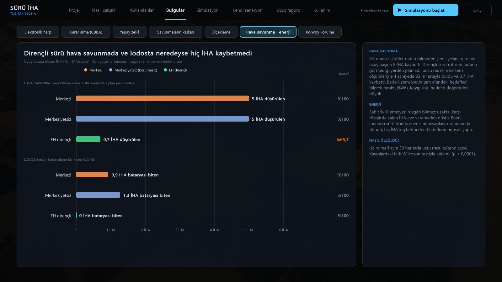

### Öne çıkan bulgular: konvoy koruma (n=30, `results/konvoy.csv`)

| Ölçüt | Merkezi | Merkeziyetsiz | Merkeziyetsiz + EH direnci |
|---|---|---|---|
| Konvoyun hedefe varması | %63,3 | %60 | **%100** |
| Kaybedilen İKA (4 araçtan) | 1,83 | 2,03 | **0** |
| … mayından / pusudan | 0,23 / 1,60 | 0,13 / 1,90 | 0 / 0 |
| Taramadan "temiz" sayılan yol parçası | 1,00 | 0,93 | **0** |
| HSS radarının imhası | %0 | %0 | **%100** |
| Kaybedilen İHA (10 İHA'dan; kamikaze dahil) | 3,90 | 4,17 | **2,2** |

Dirençli sürünün araç kaybı iki korumasız mimariden de anlamlı az (Wilcoxon p < 0,0001). Karıştırma bölgesinde korumasız
İHA, konumunu yanlış bildiği hâlde yol parçasını "temiz" bildirir; konvoy bu parçaya güvenip gizli mayına ya da pusuya
girer. Dirençli İHA hedefi görmeden "bitti" demez (spiral arama), konvoy taranmamış yolda beklemeye devam eder.
Radarın şemsiyesi altındaki yolu korumasız sürüler tarayamaz ya da tararken düşer; dirençli sürü radarı rollere bölünmüş
bir saldırıyla susturur. Bedeli: uçuş başına ortalama 2,2 İHA (radara dalan bir kamikaze ve füzeyle vurulan 1,2 İHA,
çoğu radara koşan yem).

### Öne çıkan bulgular: bilimsel kanıt (Aşama 4)

- **Ayar ve test ayrımı:** Dirençli stratejinin 4 parametresi ayrı ayar haritalarında tarandı. Hiçbir
  alternatif değer kullanılandan anlamlı iyi değil (en iyi alternatif ile fark ≤ 0,6 puan, p ≥ 0,31).
  Sonuçlar parametre seçimine duyarsız. Tek belirgin etki GPS kurtarma eşiğinde: 25 m en iyisi,
  15 ve 40 m'de puan ~1,5 düşüyor (`results/figures/ayar_duyarlilik.png`).
- **Ablasyon** (`results/figures/ablasyon.png`, mekanizma kapatılınca puan farkı, n=12):
  - **Spiral arama** en önemli mekanizma: hızlı GPS aldatmada −26,7, 30 dBm'de −14,1, hareketli
    karıştırıcıda −6,8, sabit 20 dBm'de −5,9 puan.
  - **Aldatma tespiti** (−19,3) ve **işbirlikçi konum** (−16,6) GPS aldatmasına karşı kritik.
  - **Karıştırıcı bulma** 30 dBm'de −16,0, hareketli karıştırıcıda −3,4 puan.
  - **Güven sistemi** yalnızca sinsi saldırgana karşı önemli (−6,5).
  - **Uzun TTL** hareketli karıştırıcıda −1,9 puan.
  - **Karıştırma bölgesinden kaçınma** sabit 20 dBm'de kapatılınca puan *artıyor* (+1,4, p = 0,024):
    bu kural fazla temkinli; kaçınmanın yolu uzatması, karıştırmadan kaçmanın kazancından büyük.
  - Hiçbir mekanizma tek başına korumasız sürüyle tam sistem arasındaki farkı (−6 ila −28 puan)
    açıklamıyor; dayanıklılık birbirini tamamlayan mekanizmalardan geliyor.
- **Ölçekleme** (`results/figures/olcekleme.png`): Dirençli sürü 5, 10 ve 20 İHA'da tüm koşullarda
  %100 tamamlıyor ve İHA sayısı arttıkça puanı yükseliyor (20 dBm'de 73,0 → 76,7 → 78,5). Korumasız
  merkeziyetsiz sürü 20 dBm'de 20 İHA ile %81'e düşüyor. Hesap yükü İHA sayısıyla yaklaşık doğrusal
  artıyor (dirençlide 5 → 20 İHA: simülasyon saniyesi başına 66 → 208 ms).

---

## 4. 3D modeller ve sahne

Bütün modeller kodla üretilir. Arazi, kaya ve ağaç kabuğu dokuları Poly Haven'dan alınmış fotoğraf taramalarıdır
(CC0: ücretsiz, atıf gerekmez; `tools/fetch_assets.py` indirir). İndirilmemişse kodla üretilen dokular kullanılır:

| Dosya | İçerik |
|---|---|
| `blender/drone.py` | Taktik quadcopter: aerodinamik gövde, katlanır karbon kollar, kanatlı motorlar, bükümlü pervaneler, gimbal kamera, stereo sensörler, GPS, anten, bayrak ve yazı |
| `blender/jammer.py` | 6x6 elektronik harp aracı, ekipman kabini, teleskopik direk, panel ve LPDA antenler |
| `blender/radar.py` | Hava savunma sistemi: römork üstünde dönen düzlemsel dizi anten (IFF dizisi, yan lob antenleri, arka kafes), açılmış dengeleme ayakları, jeneratör ve kabin; yanında dört tüplü füze rampası. "Anten" nesnesini Unity döndürür |
| `blender/gcs.py` | Yer kontrol istasyonu: konteyner, kafes direk, takip anteni, jeneratör, kum torbaları |
| `blender/ika.py` | 4x4 zırhlı İKA (V tabanlı eğimli gövde, sensör direğinde EO/IR kamera, uzaktan kumandalı silah kulesi, sürüş kameraları ve LIDAR, tavanda turuncu dost tanıma paneli; tekerler ve kule Unity'de döner), kamuflaj ağı altında silahlı arazi aracı ve kum torbası siperi (pusu), TM-62 benzeri tanksavar mayını ve ikaz bayrağı |
| `blender/village.py` | Orta Anadolu köyü: kiremit kırma çatılı sıvalı evler (güneş enerjili su ısıtıcılı), revaklı kubbeli minareli cami, ahşap elektrik direği |
| `blender/nature.py` | Karaçam (genç/yaşlı), meşe, çalı (alfa kesimli yaprak kartları, LOD'lu), kayalar, ot öbekleri |
| `tools/gen_textures.py` | Dikişsiz dokular: çimen, bozkır, sürülmüş tarla, anız, kaya, çakıl, kabuk, iğne, yaprak, ot, Türk bayrağı; Ulu Camii için kesme taş, iki Selçuklu oyması (yükseklik haritalı), kurşun çatı, avlu döşemesi (renk + normal + HDRP maske) |
| `tools/fetch_assets.py` | Poly Haven'dan (CC0) 2K fotoğraf dokuları: havadan çimen, kuru ot (bozkır), kuru toprak (anız), sürülmüş tarla, havadan kaya, çakıl, meşe ve çam kabuğu, taranmış kaya; karlı bölge için taze kar, havadan kar ve tekerlek izli kar; Kızılırmak için kızıl toprak, taşlı kızıl toprak ve nehir çakılı. MD5 ile doğrular, HDRP maske haritasını üretir; `C:\SuruIHA\assets\polyhaven` altına iner, lisans ve yazarlar `manifest.json`'da |
| `blender/divrigi.py` | Divriği Ulu Camii ve Darüşşifası (taç kapılar, mukarnas, kabartmalar, kırma kurşun çatılar, taş külahlar, fenerler, payandalı minare, taraça; dünya ölçekli UV, görünmeyen yüz ayıklama, atlas ve Cycles ile yıpranma pişirme), kale burçları ve sur parçası, dört Divriği evi (taş zemin kat, ahşap karkaslı üst kat, konsollu cumba) |
| `blender/kiyi.py` | Deniz feneri ve bekçi evi, iki balıkçı teknesi (kesitlerden örülen gövde), üç kıyı evi, ahşap kameriye ve göl iskelesi |
| `tools/make_portable.py` | Taşınabilir paket: uygulamanın yanına `sim` klasörü (bu bilgisayardaki Python'un yalın kopyası, numpy ve scipy, simülasyon kodu ve arazi haritaları); paketteki Python'la simülasyonu çalıştırıp dener. `full_build.ps1` her derlemede çalıştırır |
| `tools/make_sounds.py` | Seslerin sentezi (indirme yok): dört pervaneli İHA uğultusu (kanat geçiş frekansı ve harmonikleri, pervaneler arası vuru, devir düzeltmeleri, kanatlardan kopan türbülans), ova ve karlı dağ rüzgârı (esintiyle parlaklaşan gürültü), ırmak (su hışırtısı ve kabarcık çağıltısı), Akdeniz'de kıyıya vuran dalga (yavaş yükselen uğultu, köpüklü çekilme), arayüz tonları. Döngüler dikişsizdir; `C:\SuruIHA\audio` altına yazar, `full_build.ps1` her derlemede çalıştırır |
| `unity/Assets/SuruIHA/Editor/SuruIHASetup.cs` | **SürüİHA → Sahneyi Kur** menüsü: malzemeler, prefab'lar, 2,4 km ana arazi (tarla parselleri, bozkır tepeler, çam ormanı, tarla sınırında meşeler, çakıl yollar, 1,6 milyon ot öbeği), 24 evli köy ve cami, ana yol boyunca 42 direkli elektrik hattı, ufka uzanan 8 parça dağ silsilesi, gökyüzü, hacimsel bulutlar, sis |

### Görsel kalite

- **Fotoğraf tabanlı arazi:** havadan çekilmiş çimen (15 m döşeme), kuru ot bozkır (7 m, zeytinimsi gri ton), altın sarısı
  anız, sürülmüş tarla, havadan kaya (40 m), çakıl yol ve tepelerde iri toprak lekeleri (aşınmış yamaçlar). Aynı doku
  farklı katmanlarda farklı renk çarpanıyla kullanılır. Ağaç kabukları ve kayalar da fotoğraf taramasıdır (kayalarda UV
  yerine dünya uzayında üç yönlü eşleme). Her dokunun renk, normal ve HDRP maske haritası (ortam kapatma, pürüzsüzlük) var.
- **Işık:** güneş gölgesi 4096 piksel ve 32 bit derinlik, 1600 m gölge mesafesi, temas gölgeleri, mikro gölgeler; ekran
  uzayı küresel aydınlatma (SSGI: gölgeye yansıyan ışık), ekran uzayı yansımalar (SSR), ortam kapatma (SSAO).
- **Atmosfer:** fiziksel gökyüzü, gölge düşüren hacimsel bulutlar, güneş huzmeli hacimsel sis, uzak tepelerde hafif pus.
- **Kamera:** yüksek kaliteli zamansal kenar yumuşatma (TAA), ACES ton eşleme, hafif hareket bulanıklığı ve film greni;
  uzaktaki ağaç ve evler daha geç sadeleşir (LOD sapması 2), arazi siluetleri keskin (piksel hatası 1,5).
- **Kare hızı:** RTX 4060 dizüstü ekran kartında 1600×900 pencerede sinematik görünümde 44, taktik görünümde 45 fps
  (arayüz testi ölçer, `C:\SuruIHA\arayuz_testi\rapor.txt`). Kalite **K** tuşuyla düşürülebilir.

### Modelleri yeniden üretmek

```bash
"C:\Program Files\Blender Foundation\Blender 5.2\blender.exe" -b --factory-startup -P blender/drone.py -- C:\SuruIHA\models
```
```bash
.venv\Scripts\python.exe tools/gen_textures.py C:\SuruIHA\models\textures
```
Fotoğraf dokuları (bir kez, ~100 MB; internet gerekir; indirilmezse üretilen dokular kullanılır):
```bash
.venv\Scripts\python.exe tools/fetch_assets.py
```
```bash
powershell -File tools/sync_unity.ps1
```
Sonra Unity'de menüden **SürüİHA → Sahneyi Kur**, uygulama için **SürüİHA → Windows Uygulaması Derle**.

C# betiklerinde derleme hatası var mı, Unity'yi açmadan (~30 saniye; uzun derlemeden önce):
```bash
bash tools/cs_check.sh
```
Hepsini tek komutla (eşitle → sahne → önizleme → uygulama → uçtan uca test):
```bash
powershell -File tools/full_build.ps1
```
Uçtan uca test (`tools/autotest.ps1`) Python'u ve uygulamayı birlikte başlatır, farklı kamera
modlarında ekran görüntüsü alır ve `C:\SuruIHA\autotest\rapor.txt` dosyasına kare sayısı, FPS
ve görev durumunu yazar.

---

## 5. Sınırlılıklar (jüriye dürüstçe söylenecekler)

- Radyo modeli istatistiksel bir yaklaşımdır. Arazi gölgesi tek bıçak sırtı kırınımıyla hesaplanır;
  çok yollu yayılım (yansıma), bitki örtüsü ve atmosfer etkileri yoktur.
- Uçuş dinamiği nokta-kütle modelidir (ivme ve hız sınırlı). Motor ve aerodinamik modellenmemiştir.
- Karıştırma **yalnızca yazılımda** modellenmiştir. Gerçek RF yayını yapılmamıştır ve yapılmamalıdır.
- Sonuçlar simülasyon ortamına aittir. Gerçek uçuş testiyle doğrulanmamıştır.
- Sürü durum tablosu ve yuva ataması "herkes aynı bilgiyle aynı hesabı yapar" varsayımına dayanır;
  bilgiler farklıysa iki İHA aynı yuvayı seçebilir (ayrışma kuralı çarpışmayı önler).
- İHA'lar uzaktan görünsün diye 3D sahnede 3 kat büyük çizilir; bilimsel hesaplar gerçek boyutla yapılır.
- CBBA'da İHA'lar konumları değiştikçe tekliflerini günceller. Bu, klasik CBBA'nın yakınsama
  ispatının dışındadır. Pratikte yeni hedef belirdiğinde 0,2-1 s süren kısa "teklif savaşları" görülür
  (uzlaşma bunları hep çözdü, testler çakışmasız plana yakınsamayı doğruluyor).
- Güven sistemi menzil ölçümüne dayanır. Fiziksel olarak söylediği yerde duran ve konumu hakkında hiç
  yalan söylemeyen bir saldırganı (ör. gerçekten hedefe gidip "yaptım" diyen ama kamerası kapalı)
  yakalayamaz. Bu tür bir saldırgan da en azından zaman ve enerji harcamak zorunda kalır.
- Karıştırıcı bulma modeli tepelerin sinyali kestiğini hesaba katmaz. Bu yüzden sırt arkasındaki
  karıştırıcı bulunamaz (~580 m hata) ve iki karıştırıcıyı ayırmak zordur (ortalama 362 m). Arazi bilgisi
  kestirime eklenebilir ama hesap yükü ~20 kat artar.
- GPS aldatma modeli basitleştirilmiştir: aldatıcının yarıçapındaki her alıcı aynı yöne sürüklenir;
  gerçek bir aldatıcının sinyal gücü, alıcının ele geçirilme anı ve uydu geometrisi modellenmemiştir.
- Hareketli karıştırıcının takibi sabit hız varsaymayan basit bir pencereyle yapılır; ortalama hata ~136 m.
- Radar modeli tek taramalık tespit + M/N izleme yaklaşımıdır: yer yankısı (clutter), çok yollu yayılım, mikro-Doppler,
  elektronik karşı tedbir ve gerçek bir füzenin uçuş dinamiği modellenmemiştir. Radar parametreleri (menzil, füze sayısı)
  senaryo için seçilmiştir, gerçek bir sistemin değerleri değildir. Ova düz olduğu için orada arazi maskelemesi zayıftır;
  dağlık bölgelerde rota tepelerin arkasından daha çok yararlanır.
- Hava savunma sonuçları bir ödünleşimdir: dirençli sürü İHA kaybetmez ama şemsiyenin altındaki hedefleri yapmaz.
  Hedef değeri ile İHA değeri arasındaki oran farklı seçilirse karar da değişir (burada sabit bir kuralla verildi).
- Konvoy görevinde tehditlerin görülmesi kesin bir menzil kuralıdır (kamera, hava, kamuflaj olasılıksal değil); topçu
  işaretlenen mevziyi her zaman vurur. Karıştırıcı İHA, yem ve kamikaze etkileri basit çarpanlarla modellenmiştir
  (radarın gördüğü yankı −10 dB, yem ×10 kesit alanı; radar en büyük kesit alanlı hedefe öncelik verir). Rota ve
  tehditlerin yeri senaryo için seçilmiştir.
- "Karıştırma bölgesinden kaçınma" kuralı, hedef temiz hücrede olsa bile yandaki karıştırma hücreleriyle İHA'yı hedefin
  birkaç metre yanında tutabiliyor. Konvoy görevlerinde hedefe son 40 m'de kapatıldı; genel hedeflerde önceki deneylerin
  tekrarlanabilirliği için açık bırakıldı (ablasyonda bu kuralın zararlı çıkmasının bir sebebi olabilir).
- Enerji modeli 2 kg'lık bir quadcopter için yayımlanmış parametrelerle kurulmuştur; batarya yaşlanması, sıcaklık ve
  gerilim düşümü yoktur. Rüzgâr bütün alanda aynıdır (arazinin rüzgârı yönlendirmesi yok).
- Yapay zekâ bu simülatörün verisiyle eğitildi. Gerçek İHA'da yeniden eğitilmesi gerekir. Görev puanına
  katkısı küçük; asıl katkısı başarıyı daha doğru tahmin etmesi.

---

## 6. Klasör yapısı

```
suru/                 Python simülasyon paketi (config, radio, world, decision, ew, threat, energy, convoy, swarm, terrain, bridge)
suru/data/            Unity'den aktarılan arazi yükseklik haritası, eğitilmiş yapay zekâ ağırlıkları
tests/                Otomatik doğrulama testleri (pytest)
run_live.py           Unity'ye canlı yayın
run_compare.py        Yan yana karşılaştırma (iki sürü, ekran ikiye bölünür)
run_experiments.py    Toplu deney
analyze.py            Grafik ve istatistik
results/              Deney çıktıları
gorseller/            Sunum ve rapor için ekran görüntüleri
RAPOR_ISKELETI.md     TÜBİTAK 2204 rapor iskeleti (sayılar ve kaynaklar)
blender/              Blender model betikleri
tools/                Doku üretici, Unity eşitleme, kare dökümü, yapay zekâ eğitimi (train_ai.py),
                      tanıtım videosu (record_film.py, render_film.ps1, make_video.py)
sunum/                Tanıtım videosu ve poster çıktıları (MP4 git'e girmez)
unity/Assets/SuruIHA/ Unity C# scriptleri (asıl kopya burada, sync_unity.ps1 projeye kopyalar)
```
