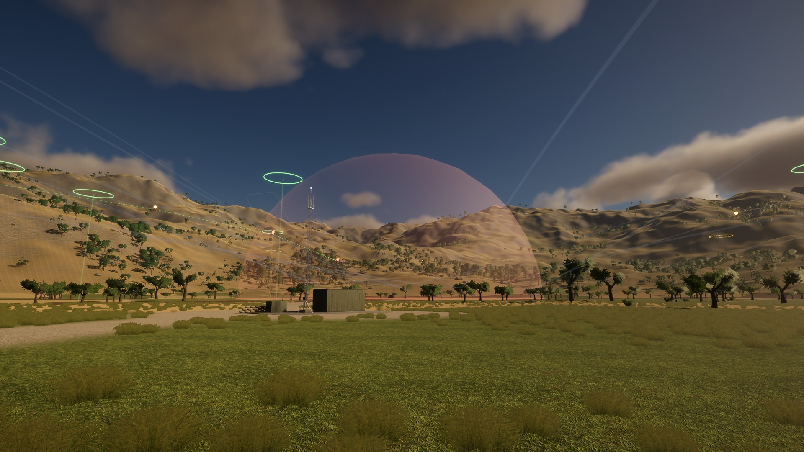

# Sürü İHA'larda Otonom Sürü Zekâsı ile Karar Alma ve Elektronik Harp Direnci

TÜBİTAK 2204-A projesi. Bir İHA sürüsünün elektronik harp (haberleşme karıştırma, GPS karıştırma,
sahte mesaj) altında görevlerini nasıl paylaştığını ve ne kadar dayanıklı olduğunu inceleyen
**Python simülasyonu** ve sonuçları gerçekçi şekilde gösteren **Unity HDRP 3D görselleştirmesi**.

```
Python (beyin)                         Unity HDRP (göz)
 suru/world.py  ── fizik, karar, EH ─┐
 suru/decision.py ─ CBBA, SGA, YZ    │
 suru/swarm.py  ── sürü zekâsı       │
 suru/terrain.py ── Unity arazisi ◄──┼─────────────── yükseklik haritası (sahne kurulumunda)
 suru/radio.py  ── SINR, paket kaybı │  UDP 5065 (JSON, 30 kare/s)
 run_live.py    ── canlı yayın ──────┴──────────────► SwarmReceiver → SwarmVisualizer
 run_experiments.py → results.csv → analyze.py → grafikler + istatistik
```

Ekran görüntüleri `gorseller/` klasöründe; TÜBİTAK rapor iskeleti `RAPOR_ISKELETI.md` dosyasında.



---

## 1. Hızlı başlangıç

### Python

```bash
py -3.14 -m venv .venv
```
```bash
.venv\Scripts\python.exe -m pip install -r requirements.txt
```

### Unity projesi

Unity projesi **`C:\SuruIHA\SuruIHA_Unity`** konumunda (Unity 6000.3.1f1, HDRP).
OneDrive dışında tutuldu, çünkü Unity'nin binlerce önbellek dosyasını OneDrive'ın eşitlemeye
çalışması projeyi bozar. Ayrıca Unity Türkçe karakterli yollarda (ğ, ı, ü) sorun çıkarabiliyor.

1. Unity Hub → **Add project from disk** → `C:\SuruIHA\SuruIHA_Unity`
2. `Assets/SuruIHA/Scenes/SuruSahnesi.unity` sahnesini aç.
3. **Play**'e bas. Ekranda "Python bağlantısı bekleniyor" yazacak.
4. Terminalde simülasyonu başlat:

```bash
.venv\Scripts\python.exe run_live.py
```

### Unity açmadan: hazır Windows uygulaması

`C:\SuruIHA\Build\SuruIHA.exe` derlenmiş, bağımsız uygulamadır. Jüriye Unity açmadan gösterebilirsin:
1. `SuruIHA.exe`'yi çift tıkla (tam ekran açılır; Alt+Enter pencereye alır, Esc kapatır).
2. Terminalde `python run_live.py` çalıştır. Sürü birkaç saniye içinde görünür.

Uygulama arka planda da çalışmaya devam eder, yani terminale geçince donmaz.

**Bir uçuşta ne görürsün:** Sürü üsten kalkar ve havada halka olur. V düzeninde kuzeydeki görev
alanına uçar. Daha yoldayken her İHA'nın planı (renkli çizgi: İHA → 1. hedef → 2. hedef → 3. hedef)
belirir. Alana varınca dağılıp planlarını uygular. Görev sırasında yeni hedefler belirir (mor dalga).
Sürü bunları birkaç saniyede kendi arasında yeniden paylaşır. Görevler bitince toplanma noktasında
yeniden halka olur, V düzeninde üsse döner ve iner. Toplam yaklaşık 3,5 dakika sürer.

**Sunum ipucu:** `python run_live.py` bir kez başlatıldıktan sonra her şeyi Unity'den yönetebilirsin.
F1/F2/F3 ile mimariyi, F4 ile planlama algoritmasını, +/- ile karıştırıcıyı, X ile saldırganı değiştir.
V ile düzeni değiştir. Z ile bir İHA'yı düşür ve planların nasıl yeniden dağıldığını göster. Y ile görev
alanına yeni bir hedef ekle ve sürünün kendi kendine kimin gideceğine karar vermesini izlet.
Aynı haritada mimarilerin ve algoritmaların farkını jüriye canlı gösterebilirsin. Sürü inince
simülasyon bekler, N ile yeni harita başlar.

**Performans:** RTX 4060 dizüstünde ölçüldü (sinematik kamera): Yüksek kalitede ~45 FPS (hacimsel sis, bulut gölgeleri, hareket bulanıklığı açık), Dengeli kalitede ~73 FPS. GPU ısınınca biraz düşer; bellek sabit, sızıntı yok. Sunumdan önce bilgisayarı prize tak, takılma olursa K ile Dengeli'ye geç.

### Canlı simülasyon seçenekleri

| Komut | Ne yapar |
|---|---|
| `python run_live.py` | Dirençli sürü, 20 dBm karıştırıcı |
| `python run_live.py --strategy centralized --jammer 30` | Merkezi mimari, güçlü karıştırma |
| `python run_live.py --strategy decentralized --spoof 0.2` | Saldırgan İHA'lı senaryo |
| `python run_live.py --jammer off --speed 3 --loop` | Karıştırıcısız, 3x hızlı, sürekli tekrar |
| `python run_live.py --formation hat --failures 2` | Hat düzeninde intikal, görevde 2 İHA arızası |
| `python run_live.py --strategy decentralized --relay` | Bağlantı koruma rölesi açık |
| `python run_live.py --planner greedy` | Eski yöntem: her İHA en yakın tek görevi alır (karşılaştırma için) |
| `python run_live.py --planner ai --jammer 30` | CBBA + yapay zekâ, güçlü karıştırma |
| `python run_live.py --popups 0` | Görev sırasında yeni hedef belirmesin (varsayılan 4) |
| `python run_live.py --jammer-mode hareketli` | Karıştırıcı araç görev alanının çevresinde devriye gezer (ayrıca: `iki`, `nokta`, `tepe`, `sirt`) |
| `python run_live.py --jammer off --gps-spoof hizli` | GPS aldatıcı (İHA'ların konumunu 2 m/s sürükler; `yavas` 0,5 m/s) |
| `python run_live.py --jammer off --spoof 0.2 --spoof-mode sneaky` | Sinsi saldırgan İHA'lar |

### Yan yana karşılaştırma (sunum için)

`run_compare.py` aynı haritada, aynı saldırı altında iki sürüyü birlikte uçurur. Unity ekranı kendiliğinden
ikiye böler: solda korumasız sürü, sağda EH dirençli sürü. İki kamera aynı açıdan bakar; her yarı yalnızca
kendi sürüsünü gösterir, arazi ortaktır. Üstteki paneller görev sayısını, puanı ve yanlış "bitti" sayısını
canlı karşılaştırır.

| Komut | Ne gösterir |
|---|---|
| `python run_compare.py` | 20 dBm sabit karıştırıcı |
| `python run_compare.py --jammer off --gps-spoof hizli` | GPS aldatma: solda İHA'lar pembe (kandırıldı), sağda sarı (fark etti) |
| `python run_compare.py --jammer-mode iki` | İki karıştırıcı (en büyük fark: %39'a karşı %99,5) |
| `python run_compare.py --jammer off --spoof 0.2 --spoof-mode sneaky` | Sinsi saldırgan İHA'lar |
| `python run_compare.py --left centralized` | Solda merkezi mimari |

Kısayollar canlı moddakiyle aynıdır. **Z** (arıza) iki tarafta aynı İHA'yı düşürür, **Y** (yeni hedef) iki
tarafta aynı yerde belirir; böylece karşılaştırma adil kalır. Sol sürü UDP 5065'ten, sağ sürü 5067'den gelir.

### Tanıtım videosu

Video tamamen bu depodaki araçlarla üretilir; ek program indirmek gerekmez (kodlama Blender'ın içindeki
FFmpeg ile yapılır).

```
.venv\Scripts\python.exe tools\record_film.py          # 1) uçuşları kaydeder, çekim senaryosu ve kartları yazar
powershell -File tools\render_film.ps1                 # 2) Unity kareleri çeker, 3) Blender MP4 yapar
```

1. `record_film.py` üç uçuşu kare kare kaydeder (dirençli sürü 20 dBm; GPS aldatma ve iki karıştırıcı
   için yan yana çiftler). Alana varış, yeni hedef, GPS kaybı, spiral arama, karıştırıcının bulunması ve
   dönüş anlarını kayıttan kendisi bulur ve çekimleri bunlara göre kurar. Sonuç kartlarını
   `results/*.csv` verisinden çizer. Yalnızca kurgu değiştiyse `--reuse` yeniden uçurmadan çalışır.
2. `SuruIHA.exe -suruFilm C:\SuruIHA\film\film.json` kayıtları oynatır ve her kareyi JPG olarak yazar. Oyun
   zamanı sabit adımlıdır, bu yüzden bilgisayar yavaş da olsa video akıcıdır.
3. `tools/make_video.py` (Blender arka planda) kartları, kareleri, alt yazıları ve yan yana etiketlerini
   birleştirip `sunum/tanitim_videosu.mp4` dosyasını yazar (1920×1080, 30 kare/s, H.264, ~2 dk).

Her video karesi 0,1 s simülasyondur; video 3 kat hızlıdır ve bu ekranda yazar. MP4 git'e girmez.

### Unity kısayolları

| Tuş | İşlev |
|---|---|
| **C** | Sinematik kamera (açılışta bu) |
| **O** | Serbest kamera: fare ile döndür, tekerlekle yakınlaş, WASD/QE ile kaydır, Shift hızlı |
| **F**, **Tab**, **1-9** | İHA takip kamerası |
| **T** | Taktik kuşbakışı |
| **L** | Haberleşme bağlantılarını göster/gizle |
| **G** | "İHA'nın sandığı konum" hayaletlerini göster/gizle |
| **J** | Dirençli sürünün ortak karıştırma haritası |
| **B** | Uzaktan görünen İHA işaretleri (durum renginde parlayan noktalar) |
| **P** | İHA'ların planlı rotalarını göster/gizle |
| **F1 / F2 / F3** | Senaryo: merkezi / merkeziyetsiz / dirençli mimari (Python'u yeniden başlatmadan) |
| **F4** | Planlama algoritması: açgözlü tek görev → CBBA → CBBA + yapay zekâ |
| **Y** | Görev alanına yeni bir hedef ekle (en fazla 8; yer istasyonu ihbarı gibi) |
| **+ / -** | Karıştırıcı gücü: kapalı → 10 → 20 → 30 dBm |
| **M** | Karıştırıcı türü: sabit → hareketli → iki → nokta (FHSS testi) → tepede → sırt arkasında |
| **U** | GPS aldatıcı: yok → hızlı → yavaş |
| **X** | Saldırgan İHA'lar (%20): yok → saf → sinsi |
| **N** | Yeni harita (farklı görev noktaları) |
| **V** | Düzen tipi: V → hat → kol → halka (uçuşu yeniden başlatmadan) |
| **Z** | Rastgele bir İHA'yı arızalandır (düşer, sürü görevlerini ve düzeni yeniden dağıtır) |
| **K** | Grafik kalitesi: Yüksek → Dengeli → Performans (panelde FPS görünür) |
| **Esc** | Uygulamadan çık (yalnızca SuruIHA.exe) |
| **H** | Bilgi panelini gizle |

**Renkler:** İHA ışığı yeşil = normal, turuncu = karıştırılıyor, kırmızı = GPS yok, mavi = spiral
arama yapıyor, mor = saldırgan, camgöbeği = röle (koruduğu arkadaşına çizgiyle bağlı), sönük = arızalı. Bağlantı çizgisi yeşilden kırmızıya sinyal kalitesini gösterir.
Görev halkası beyaz = açık, sarı = bir İHA yolda, yeşil = tamamlandı, kırmızı = yanlış tamamlandı,
yanıp sönen mor = yeni belirdi ama sürü henüz bilmiyor. İç içe halka sayısı görevin önceliğidir (1-3).
Renkli çizgiler her İHA'nın planıdır: ilk hedefe giden kısım kalın, sonrakiler ince.
Pembe İHA = GPS'i aldatılıyor (henüz fark etmedi), sarı = aldatmayı fark etti. Kırmızı kubbe = geniş bant,
kehribar = nokta karıştırıcı, camgöbeği kubbe = GPS aldatıcı. Turuncu nişangâh, sürünün karıştırıcının
yeri için tahminidir; beyaz çizgi tahmin ile gerçek karıştırıcı arasındaki hatayı gösterir.

---

## 2. Bilimsel model

### Radyo ve elektronik harp (`suru/radio.py`)
- 2.4 GHz, log-mesafe yol kaybı: `PL(d) = 40 + 10·2.5·log10(d)` dB
- Her bağlantı için **SINR** = sinyal − (gürültü + karıştırma); paket kaybı olasılığı lojistik eğri:
  `PER = 1 / (1 + e^(0.8·(SINR − 10)))`
- Karıştırıcı gücü her alıcıda mesafeye göre hesaplanır. İrtifa ve mesafe gerçekten önemlidir.
- **GPS karıştırma:** Alınan karıştırma gücü −80 dBm'yi aşarsa GPS kesilir. İHA IMU ile ölü hesap
  yapar, hata rastgele yürüyüşle `σ² = σ0² + q²t³/3` şeklinde büyür.
- **Sahte bilgi (spoofing):** Ele geçirilmiş İHA'lar sahte görev teklifi yayar (merkezi mimaride
  istasyona sahte "tamamlandı" raporu gönderir).

### Karşılaştırılan üç karar alma mimarisi (`suru/world.py`)
1. **Merkezi:** Görevleri yer istasyonu dağıtır (SGA). İHA'lar yalnızca istasyonla konuşur.
2. **Merkeziyetsiz:** İHA'lar komşularıyla dedikodu (gossip) protokolüyle konuşur, görevleri
   **CBBA** ile kendi aralarında paylaşır. Lider yok.
3. **Merkeziyetsiz + EH direnci** (projenin özgün katkısı):
   - karıştırmayı algılama ve **ortak karıştırma haritası**
   - karıştırma bölgesindeki arkadaşın sessizliğini "kayıp" değil "meşgul" sayma (uzun TTL)
   - karıştırma bölgesinden transit geçmeme, oradaki görevleri sona bırakma
   - GPS'i olmayan İHA'nın GPS'li komşulardan **işbirlikçi konum düzeltmesi**
   - konum belirsizliği büyükse hedefte **spiral arama** (kamera 15 m'den tanır, görsel güdümle
     üstüne gelir), bulamazsa "bitti" demeyip yeniden deneme
   - **GPS kurtarma:** konum belirsizliği 25 m'yi aşan İHA görevini bırakıp son GPS aldığı noktaya
     döner, konumu düzelince geri gelir (her yer karıştırılıyorsa denemez)
   - konum belirsizliğinin zaman maliyetini (beklenen arama süresi) tekliflere katma
   - **güven sistemi**: makullük kontrolü + itibar (sinsi saldırgana karşı, aşağıda)
   - **karıştırıcıyı bulma**, **frekans atlama (FHSS)**, **GPS aldatma tespiti** (aşağıda)

   Her mekanizma ayrı bir ayarla kapatılabilir (`ew_jam_map`, `ew_trust`...); ablasyon deneyi bunlarla yapılır.

### Elektronik harp (`suru/ew.py`, `suru/radio.py`)
- **Arazi gölgesi:** Tepeler radyo sinyalini keser. Verici ile alıcı arasındaki görüş hattını en çok
  kesen tepe bulunur ve ITU-R P.526 tek bıçak sırtı kırınım kaybı eklenir:
  `v = h·√(2d/(λ·d1·d2))`, `J(v) = 6,9 + 20·log10(√((v−0,1)²+1) + v − 0,1)` dB. Hat tepeyi rahatça
  aşıyorsa kayıp 0, tepe hattı tam kesiyorsa ~6 dB, arkasında kalınmışsa 15-30 dB. Hem İHA'lar
  arası, hem yer istasyonu, hem de karıştırıcı sinyaline uygulanır.
- **Karıştırıcı türleri:** *Geniş bant* bütün 2,4 GHz bandına ve GPS'e gürültü basar. *Nokta*
  karıştırıcı gücünü haberleşme kanalına yığar: kanalda 6,2 dB daha güçlüdür, GPS'e dokunmaz.
  Karıştırıcı **hareket edebilir** (araç görev alanının çevresinde 5 m/s ile devriye gezer), **birden
  fazla** olabilir, **tepeye** (her yeri yukarıdan görür) ya da **sırtın arkasına** (tepeler sinyalinin
  bir kısmını keser) konabilir. Dirençli sürünün karıştırma haritası zaman damgalıdır;
  hareketli karıştırıcının eski konumu 90 s içinde unutulur.
- **Frekans atlama (FHSS):** Dirençli sürü haberleşme frekansını sürekli değiştirir. Nokta karıştırıcı
  paketlerin yalnızca %24'üne (20/83,5 MHz) denk gelir. Geniş bant karıştırıcıya karşı ise işe yaramaz;
  bu klasik sonuç simülasyonda da görülür.
- **Karıştırıcıyı bulma:** Her dirençli İHA saniyede bir ölçtüğü karıştırma gücünü (konum, dBm)
  kaydeder; ölçümler dedikoduyla yayılır. Model `ölçülen = P − PL(mesafe)`. Her aday konum için en
  iyi güç kapalı formda bulunur (en küçük kareler), en iyi aday kaba → ince ızgarayla aranır. Tek
  kaynak modeli şüpheliyse iki kaynaklı model denenir: en güçlü ölçümler k-ortalamalarla iki kümeye
  ayrılır, kaynaklar dönüşümlü ve yeniden ağırlıklandırılmış en küçük karelerle aranır. Bulunan
  karıştırıcıdan karıştırma alanı **önceden kestirilir**: sürü henüz girmediği karıştırılan hücreleri
  de bilir ve GPS kurtarmada en yakın güvenli kenara gider. Konumundan emin olmayan İHA ölçüm
  kaydetmez. Karıştırıcının en fazla 2 W olduğu kabul edilir; bu, "uzakta tek bir aşırı güçlü kaynak"
  gibi yanıltıcı çözümleri engeller.
- **GPS aldatma:** Yerdeki aldatıcı, 250 m içine giren İHA'nın GPS alıcısını sahte sinyalle ele
  geçirir ve bildirdiği konumu doğuya doğru sürükler (hızlı: 2 m/s, yavaş: 0,5 m/s). İHA "GPS
  sağlam" sanır ve hedefe vardığını zanneder. Dirençli sürünün tespit yolları:
  1. **IMU tutarlılığı:** Son 10 s'de GPS'in söylediği yer değiştirme, IMU'nun ölçtüğünden 5σ'dan fazla
     sapıyorsa GPS'e güvenilmez (hızlı sürükleme ~8 s'de yakalanır).
  2. **Komşu menzili:** İHA'lar birbirine uzaklığı telsizle ölçer (±1 m). GPS konumlarından hesaplanan
     uzaklıklar komşuların çoğunda tutmuyorsa GPS sahtedir.
  3. **"Hedef yok" çıkarımı:** GPS'i sağlamken hedefin üstüne geldiği hâlde aramada da bulamayan İHA,
     konumunun yanlış olduğunu anlar. Yavaş sürükleme genellikle böyle yakalanır.

  Aldatmayı fark eden İHA IMU ile devam eder, belirsizliğini büyütür, aldatma bölgesinden çıkar.
  GPS hem IMU hem komşularla 10 s tutarlı olunca yeniden güvenir.
- **Sinsi saldırgan ve güven sistemi:** Saf saldırgan her görevi "ben oradayım" diye ister ve kolay
  yakalanır. Sinsi saldırgan daha kurnazdır:
  - en fazla 2 görevi konumuyla tutarlı (makul) tekliflerle kilitler ama oraya gitmez,
  - her 10 s'de bir açık bir görevi "tamamladım" diye yayar ve o an kendini hedefin üstünde gösterir.

  Dirençli İHA'lar her komşu için bir **itibar** (Beta dağılımı) tutar ve üç tür kanıt toplar:
  - **menzil:** komşunun bildirdiği konum, telsizle ölçülen uzaklıkla tutuyor mu?
  - **hız:** bildirdiği konum uçamayacağı kadar mı sıçradı?
  - **ilerleme:** "gidiyorum" dediği hedefe 30 s'dir yaklaşmıyor mu?

  Kendi konumu bozuk olan İHA herkesi suçlamasın diye, bir komşu ancak diğerlerine göre aykırıysa
  suçlanır. İtibarı düşen İHA dışlanır. Güvenilen **en az iki ayrı** arkadaşın dışladığı İHA da
  dışlanır (iki bağımsız tanık: tek bir yalancı kimseyi karalayamaz). "Tamamlandı" bilgisi ilk
  bildireni (kaynağı) ile yayılır. Bir İHA dışlanınca onun bildirdiği "tamamlandı"lar geri alınır ve
  görev yeniden açılır.
- **Öngörülü çarpışma önleme:** Her İHA çifti için en yakın yaklaşma noktası (CPA) hesaplanır. 5 s
  içinde 10 m'den yakına gelecekler varsa biri yükselir, öbürü alçalır ve yana açılırlar. (Kafa kafaya
  24 m/s yaklaşan iki İHA, 10 m kala fark etse ivme sınırı yüzünden kaçamaz.)

### Otonom karar alma (`suru/decision.py`)
- **Görev değeri ve aciliyet:** Her hedefin bir önceliği (1-3) vardır, değeri beklendikçe azalır:
  `ödül = değer · 0.99^(varış − görünme)`. Görev puanı (0-100) = alınan ödül / toplam değer.
- **Yeni beliren hedefler:** Görev sırasında yeni hedefler belirir. Yer istasyonu ihbarı (radyo
  bağlantısı varsa) ya da yakından geçen İHA'nın sensörü (120 m) ile öğrenilir, dedikoduyla yayılır.
- **CBBA (Consensus-Based Bundle Algorithm, Choi ve ark. 2009):** Her İHA 3 görevlik bir **paket**
  planlar. Her adımda rotasına en çok değer katan görevi en uygun sıraya ekler (geciktirdiği görevlerin
  kaybı düşülür). Komşular kazanan listelerini değiş tokuş eder; Choi'nin uzlaşma kuralları zaman
  damgalarına bakıp hangi bilginin daha yeni olduğuna karar verir. Teklifi geçilen İHA o görevi ve
  paketinde ondan sonra gelenleri bırakır. Yakınsama için teklifler "bükülür" (azalan marjinal kazanç).
- **SGA (merkezi):** Yer istasyonu her saniye tüm (İHA, görev) çiftleri içinden en büyük kazancı
  vereni sırayla atar. Bağlantı tamken CBBA ile aynı kaliteye yakınsar.
- **Açgözlü tek görev (eski yöntem):** Her İHA en yakın tek görevi açık artırmayla alır. Karşılaştırma
  için korunmuştur (`--planner greedy`).
- **Dinamik yeniden planlama:** Yeni hedef belirince, bir İHA düşünce (sessizliği teklif süresini
  aşınca) ya da bir İHA daha iyi teklif verince paketler kendiliğinden yeniden kurulur.
- **Yapay zekâ (`--planner ai`):** Küçük bir sinir ağı (8 girdi → 8 gizli nöron → 1 çıktı) her İHA-görev
  çifti için **görev başarı olasılığını** kestirir. CBBA da **beklenen ödülü** (olasılık × değer × zaman
  azalması) en büyütür. Girdiler: görev ve yol karıştırma bölgesinde mi, İHA'nın GPS'i ve konum
  belirsizliği, aldığı karıştırma gücü, uzaklık, görev değeri, komşu sayısı.
  Ağ **deneyimden öğrenir** (denetimli öğrenme, `tools/train_ai.py`). Sürü eğitim haritalarında
  (seed 1000+) 360 görev uçuşu yapar, her "İHA hedefe yöneldi" anı kaydedilir (~10 700 örnek), sonucu
  "buldu / bulamadı" olarak etiketlenir. Ağ geri yayılım ve Adam yöntemiyle eğitilir, doğrulama
  haritalarında erken durdurulur. Hiç görmediği test haritalarında ölçülür.
- **İlk deneme (dürüst not):** Ağı önce evrim stratejileriyle (pekiştirmeli öğrenme) doğrudan görev
  puanını artıracak şekilde eğitmeyi denedik (`tools/train_ai_es.py`). 25 kuşakta öğrenemedi. Sebepleri:
  ağın başlatılma biçimi (düzeltildi) ve görev puanının koşudan koşuya oynamasının görev
  değerlendirmenin etkisinden büyük olması. Başarı olasılığını kestirmek çok daha güçlü bir öğrenme sinyali veriyor.

### Sürü zekâsı (`suru/swarm.py`, `suru/world.py`)
- **Görev akışı:** kalkış → düzende intikal → dağılıp görev → toplanma → düzende dönüş → iniş.
  Her İHA kendi evresine kendisi karar verir, lider yoktur.
- **Lidersiz düzen uçuşu (V, hat, kol, halka):** Her İHA, düzenin ortasındaki "sanal liderin" rota
  üzerindeki ilerlemesini tahmin eder ve komşularıyla **uzlaşır** (ortalama konsensüs):
  `s_i ← s_i + g · ortalama(s_j − s_i)`. Geride kalan olursa sanal lider yavaşlar.
  Karıştırma uzlaşmayı bozar; elektronik harbin sürü davranışına etkisi böylece doğrudan görülür.
- **Yuva ataması:** Düzen değişirken yollar kesişmesin diye yuvalar her saniye "toplam uzaklık en
  küçük" olacak şekilde **Macar algoritmasıyla** yeniden dağıtılır.
- **Reynolds kuralları:** ayrışma (yaklaşma hızını da sönümleyen çarpışma önleme), hizalanma, uyum.
  Görevde İHA'lar ±6 m'lik irtifa katmanlarında uçar.
- **Arazi takibi:** Unity'deki arazi birebir simülasyona aktarılır (4 m çözünürlüklü yükseklik
  haritası). İHA'lar 4 s ileriye bakarak tepelerden önce yükselir. GPS gidip konum kayarsa
  radar altimetre emniyeti devreye girer.
- **Toplanma kararı:** Bir İHA, haberini aldığı tüm arkadaşları toplanma noktasına gelmeden
  dönüşe geçmez; görevi süren arkadaşını bekler (dedikoduyla yayılan sürü durum tablosu).
- **Üye kaybı:** Düşen İHA'nın görevleri teklif süresi dolunca diğerlerine geçer; düzen kalan
  İHA'larla yeniden kurulur.
- **Bağlantı koruma rölesi (isteğe bağlı, `--relay`):** Kopan arkadaş varsa, herkes aynı bilgiyle
  aynı seçimi yapar ve en uygun İHA aradaki noktaya giderek röle olur.

### Ölçülen metrikler
Görev tamamlama oranı, **görev puanı** (zamanla azalan görev değerleri, 0-100), görev süresi (kalkış ve
intikal dahil), **yeni hedefe tepki süresi**, **görev alanında katedilen yol** (enerji göstergesi),
**yeniden planlama** (en az 2 s izlenmiş hedefin bırakılması), yanlış tamamlama (İHA bitti sandı ama
hedef görülmedi), gereksiz tekrar ziyaret, paket iletim oranı, ortalama konum hatası, sürü
bağlantılılığı (en büyük bağlı grubun oranı), düzen yuva hatası (gerçek konumla), en düşük yerden
yükseklik, yakın geçiş (iki İHA'nın 2 m'den fazla yaklaşması).

### Doğrulama
```bash
.venv\Scripts\python.exe -m pytest tests -q
```
29 otomatik test: radyo fiziği, düzen geometrisi, tam uçuş (kalkıştan inişe, hiç yakın geçiş olmadan),
arazi takibi, karıştırmanın düzeni bozması, İHA arızası sonrası görev paylaşımı, eşleştirilmiş deney.
Karar alma için: en iyi ekleme hesabının kaba kuvvetle aynı sonucu vermesi, Choi uzlaşma kuralları,
CBBA'nın çakışmasız ve ortak plana yakınsaması, CBBA'nın açgözlü yöntemden iyi olması, yeni ve
elle eklenen hedeflerin yapılması, sahte teklife dayanıklılık, yapay zekâ ağı.
Elektronik harp için: bıçak sırtı kırınımı (tepenin arkasında > 20 dB kayıp, açıkta 0), nokta
karıştırıcının GPS'e dokunmaması ve frekans atlamanın paket kaybını azaltması, hareketli karıştırıcının
yol alması, bir ve iki karıştırıcının 40 m'den iyi bulunması, GPS aldatmanın 20 s içinde tespiti,
sinsi saldırganların dışlanması ve dürüstlerin dışlanmaması.

---

## 3. Deneyler

```bash
.venv\Scripts\python.exe run_experiments.py
```
```bash
.venv\Scripts\python.exe run_experiments.py --swarm
```
```bash
.venv\Scripts\python.exe tools/train_ai.py
```
```bash
.venv\Scripts\python.exe run_experiments.py --decision
```
```bash
.venv\Scripts\python.exe run_experiments.py --ew
```
```bash
.venv\Scripts\python.exe run_experiments.py --tune
```
```bash
.venv\Scripts\python.exe run_experiments.py --ablation
```
```bash
.venv\Scripts\python.exe run_experiments.py --scaling
```
```bash
.venv\Scripts\python.exe analyze.py
```

| Deney | İçerik | Koşu |
|---|---|---|
| Ana | 3 strateji × 4 karıştırıcı gücü × 2 saldırgan oranı × 30 tekrar | 720 |
| Sürü (`--swarm`) | üye kaybı (0/2/4 İHA düşer) ve röle (menzil 180 m) | 660 |
| Karar alma (`--decision`) | açgözlü / CBBA / yapay zekâ / kuralsız × 5 koşul × 30, 6 yeni hedef; paket büyüklüğü 1-6 | 1500 |
| Elektronik harp (`--ew`) | 9 senaryo × 3 strateji × 30; arazi gölgesi kapalı karşılaştırması | 1080 |
| Ayar (`--tune`) | 4 parametre × 3 değer × 3 senaryo, **ayrı ayar haritaları** (seed 500-519) | 540 |
| Ablasyon (`--ablation`) | 11 mekanizma tek tek kapalı + tam + korumasız × 6 senaryo × 12 | 936 |
| Ölçekleme (`--scaling`) | 5 / 10 / 20 İHA × 3 strateji × 3 koşul × 20 | 540 |
| Yapay zekâ (`tools/train_ai.py`) | eğitim / doğrulama / test haritaları ayrı, ~20 000 görev denemesi | 570 uçuş |

- Aynı tohum (seed) = aynı görev haritası olduğu için stratejiler birebir aynı koşulda
  karşılaştırılır (eşleştirilmiş deney → Wilcoxon testi).
- Test haritaları (seed 0-29) ne parametre ayarında ne yapay zekâ eğitiminde kullanıldı.
- Çıktılar: `results/*.csv`, `results/figures/*.png`, `results/istatistik.txt`, `results/ai_egitim.txt`.

### Öne çıkan bulgular: elektronik harp (görev tamamlama oranı, ortalama ± std, n=30)

| Koşul | Merkezi | Merkeziyetsiz | **Dirençli** |
|---|---|---|---|
| Karıştırıcı yok | %100 | %100 | **%100** |
| 10 dBm karıştırma | %99,3 ± 2,2 | %99,7 ± 1,3 | **%100** |
| 20 dBm karıştırma | %87,3 ± 7,8 | %87,5 ± 8,9 | **%100** |
| 30 dBm karıştırma | %12,3 ± 7,2 | %16,7 ± 10,5 | **%66,5 ± 19,4** |
| %20 saldırgan, karıştırma yok | %20,7 ± 3,7 | %0,0 | **%100** |
| %20 saldırgan + 20 dBm | %22,7 ± 7,2 | %0,0 | **%100** |
| 20 dBm + görevde 4 İHA düşer | %86,2 ± 7,5 | %88,3 ± 7,6 | **%100** |

Elektronik harp senaryoları (her uçuşta 6 yeni hedef, n=30; dirençli diğer ikisinden hepsinde anlamlı iyi, p < 10⁻⁶):

| Senaryo | Merkezi | Merkeziyetsiz | **Dirençli** |
|---|---|---|---|
| Sabit 20 dBm | %86,9 | %89,4 | **%100** |
| Hareketli 20 dBm | %83,7 | %85,9 | **%100** |
| İki karıştırıcı 20 dBm | %40,4 | %39,4 | **%99,5** |
| Nokta 25 dBm (yalnızca haberleşme) | %74,5 | %99,9 | **%100** |
| Tepede 25 dBm | %73,7 | %79,0 | **%100** |
| Sırt arkasında 30 dBm | %91,5 | %92,1 | **%100** |
| GPS aldatma, hızlı (2 m/s) | %51,9 | %50,5 | **%98,6** |
| GPS aldatma, yavaş (0,5 m/s) | %61,2 | %61,4 | **%99,1** |
| Sinsi saldırgan %20 | %32,4 | %86,8 | **%100** |

- **20 dBm'de dirençli sürü hem başarılı hem hızlı:** görev süresi 113 s, diğerleri 145-169 s.
  Yanlış "bitti" sayısı 0 (diğerlerinde 2,7-3,2).
- **30 dBm'de** bütün alan karıştırılıyor ve GPS kalkıştan itibaren yok. Merkezi ve korumasız sürüler
  %12-17'de kalıyor, dirençli sürü %66,5'e ulaşıyor (p < 10⁻⁵). Düzenini koruyan da yalnızca o:
  gerçek yuva hatası 39 m, diğerlerinde 126-145 m.
- **GPS aldatmada** korumasız sürüler hedefe vardığını sanıp ortalama 10-13 yanlış "bitti" diyor.
  Dirençli sürü hızlı sürüklemeyi ortalama 9,4 s'de yakalıyor (uçuş başına 0,03 yanlış alarm). Yavaş
  sürüklemeyi 52 s'de, çoğunlukla "hedefin üstündeyim ama göremiyorum, demek ki konumum yanlış"
  çıkarımıyla yakalıyor. Bedeli: görev 2 kat uzun sürüyor (206-236 s), çünkü aldatma bölgesinde GPS'siz
  çalışılıyor.
- **Sinsi saldırganı** dirençli sürü her uçuşta dışlıyor (%100), dürüst bir arkadaşı yanlışlıkla dışlama
  oranı %0,1. Korumasız merkeziyetsiz sürü saf saldırgana karşı tamamen çöküyor (%0). Sinsi saldırgan
  ise onu %86,8'de bırakıyor: daha az zarar veriyor ama fark edilmiyor. Merkezilikte sahte "tamamlandı"
  raporları sürüyü %32'ye düşürüyor.
- **Karıştırıcıyı bulma:**
  - Sabit karıştırıcı her uçuşta ilk ~30 s'de 50 m'den iyi bulunuyor (görev sonunda ortalama 40 m hata).
  - Hareketli karıştırıcı uçuşların %97'sinde bir noktada 50 m'den iyi yakalanıyor, ama ortalama takip
    hatası 136 m.
  - İki karıştırıcıyı ayırmak zor: ortalama hata 362 m, uçuşların %93'ünde bir noktada (ortalama 168 s)
    50 m'den iyi.
  - Sırt arkasındaki karıştırıcı bulunamıyor (~580 m), çünkü kestirim modeli tepelerin sinyali
    kestiğini hesaba katmıyor.
- **Arazi gölgesi:** Ovadaki karıştırıcıda arazinin etkisi yok (sonuçlar birebir aynı). Sırt arkasındaki
  30 dBm karıştırıcıda tepeler kalkan oluyor: arazi yok sayılsaydı merkezi ve korumasız sürüler
  %67 ve %65'te kalırdı, gerçekte %92 tamamlıyorlar (p < 10⁻⁸). Gerçekçi arazi modeli sonucu değiştiriyor.
- **Frekans atlama:** Nokta karıştırıcı haberleşmeyi bozar ama GPS'e dokunmaz. Bu yüzden korumasız
  merkeziyetsiz sürü bile %99,9 tamamlıyor. Frekans atlamanın ablasyondaki katkısı küçük (−1,5 puan,
  p = 0,052). Yıldız mimarideki merkezi sürü yer istasyonu bağlantısı kopunca %74,5'e düşüyor.
- **Üye kaybı:** Karıştırma yokken 4 İHA düşünce görev süresi merkezide 95 → 124 s, merkeziyetsizde
  97 → 116 s, dirençlide 97 → 118 s uzuyor. 20 dBm'de 4 İHA düşünce de dirençli sürü %100 bitiriyor.
- **Röle:** Kısa menzilde (180 m) bağlantılılığı %74-75'ten %81'e çıkarıyor (p < 10⁻⁵) ama görevi
  69-74 s uzatıyor. Görevler zaten %100 bitiyor. Bu bir **ödünleşim**.
- **Bedel:** Zayıf karıştırmada (10 dBm) dirençli sürü daha yavaş: 121 s, diğerleri 95-98 s.

### Öne çıkan bulgular: otonom karar alma (görev puanı 0-100, n=30, 6 yeni hedef)

| Koşul | Mimari | Açgözlü | **CBBA** | Fark (p) |
|---|---|---|---|---|
| Karıştırma yok | Merkezi (SGA) | 73,3 | **83,0** | +9,7 (p < 10⁻⁸) |
| Karıştırma yok | Merkeziyetsiz | 75,5 | **79,6** | +4,1 (p < 10⁻⁶) |
| Karıştırma yok | Dirençli | 75,4 | **79,5** | +4,1 (p < 10⁻⁶) |
| 20 dBm | Merkezi (SGA) | 58,5 | **66,9** | +8,4 (p < 10⁻⁷) |
| 20 dBm | Merkeziyetsiz | 63,9 | **70,6** | +6,7 (p < 10⁻⁵) |
| 20 dBm | Dirençli | 72,5 | **77,8** | +5,3 (p < 10⁻⁷) |
| 30 dBm | Dirençli | 24,5 | 26,8 | +2,3 (p = 0,17, anlamsız) |
| %20 saldırgan | Dirençli | 71,5 | **77,0** | +5,6 (p < 10⁻⁷) |
| 20 dBm + 3 arıza | Dirençli | 69,8 | **73,5** | +3,7 (p < 10⁻⁴) |

- **CBBA paket planlama**, açgözlü tek görev yöntemine göre görev puanını her mimaride anlamlı artırıyor.
  Karıştırma yokken görev alanında katedilen yol dirençlide 6,3 km'den 5,2 km'ye, merkezide 8,1 km'den
  5,1 km'ye iniyor. Yeni hedefe varış merkezide 29 s'den 13 s'ye düşüyor.
- **30 dBm'de** fark anlamsız: her yer GPS'siz olunca planlamanın inceliği önemini yitiriyor. Açgözlü
  yöntem burada daha çok görev tamamlıyor (%67 / %58), CBBA ise önemli hedeflere öncelik veriyor.
- **Paket büyüklüğü:** 1 görevlik paketten 3'e çıkınca puan anlamlı artıyor (karıştırma yok +1,7;
  20 dBm +3,1 puan, p < 10⁻³). 3'ten sonrası düz. Kullanılan değer 3.
- **Yapay zekâ:**
  - Görev başarısını uzman kuralından daha iyi tahmin ediyor. Test haritalarında ROC AUC 0,978,
    uzman kuralında 0,948; 30 dBm'de 0,880'e 0,760. Doğruluk %92,8 ("hep başarır" demek %73,2 verirdi).
    Kestirimler iyi kalibre: 25 dBm'de gerçek başarı %59,9, kestirim %60,8.
  - Görev puanına katkısı küçük: karıştırma yokken +0,6 (p = 0,017), %20 saldırganla +0,9 (p = 0,002).
    20 dBm, 30 dBm ve arızada fark anlamsız. Sebep: görev değerlendirmenin puana etkisi zaten küçük.
    Uzman kuralının kuralsız CBBA'ya üstünlüğü bile hiçbir koşulda anlamlı değil.
  - Sürüyü dayanıklı yapan değerlendirme değil, davranış kuralları; bunu aşağıdaki ablasyon gösteriyor.
- **Yapay zekâ ne öğrendi** (`results/figures/ai_ne_ogrendi.png`): Uzman kuralı konumunu kaybetmiş
  İHA'ya fazla kötümser bakıyor, ağ spiral arama sayesinde başarının sürdüğünü öğrenmiş. Karıştırma
  bölgesindeki göreve uzman kuralı herkese ceza veriyor. Ağ ise "İHA'nın şu an GPS'i varsa oraya gidip
  başarır" diyor.

### Öne çıkan bulgular: bilimsel kanıt (Aşama 4)

- **Ayar ve test ayrımı:** Dirençli stratejinin 4 parametresi ayrı ayar haritalarında tarandı. Hiçbir
  alternatif değer kullanılandan anlamlı iyi değil (en iyi alternatif ile fark ≤ 0,6 puan, p ≥ 0,31).
  Sonuçlar parametre seçimine duyarsız. Tek belirgin etki GPS kurtarma eşiğinde: 25 m en iyisi,
  15 ve 40 m'de puan ~1,5 düşüyor (`results/figures/ayar_duyarlilik.png`).
- **Ablasyon** (`results/figures/ablasyon.png`, mekanizma kapatılınca puan farkı, n=12):
  - **Spiral arama** en önemli mekanizma: hızlı GPS aldatmada −26,7, 30 dBm'de −14,1, hareketli
    karıştırıcıda −6,8, sabit 20 dBm'de −5,9 puan.
  - **Aldatma tespiti** (−19,3) ve **işbirlikçi konum** (−16,6) GPS aldatmasına karşı kritik.
  - **Karıştırıcı bulma** 30 dBm'de −16,0, hareketli karıştırıcıda −3,4 puan.
  - **Güven sistemi** yalnızca sinsi saldırgana karşı önemli (−6,5).
  - **Uzun TTL** hareketli karıştırıcıda −1,9 puan.
  - **Karıştırma bölgesinden kaçınma** sabit 20 dBm'de kapatılınca puan *artıyor* (+1,4, p = 0,024):
    bu kural fazla temkinli; kaçınmanın yolu uzatması, karıştırmadan kaçmanın kazancından büyük.
  - Hiçbir mekanizma tek başına korumasız sürüyle tam sistem arasındaki farkı (−6 ila −28 puan)
    açıklamıyor; dayanıklılık birbirini tamamlayan mekanizmalardan geliyor.
- **Ölçekleme** (`results/figures/olcekleme.png`): Dirençli sürü 5, 10 ve 20 İHA'da tüm koşullarda
  %100 tamamlıyor ve İHA sayısı arttıkça puanı yükseliyor (20 dBm'de 73,0 → 76,7 → 78,5). Korumasız
  merkeziyetsiz sürü 20 dBm'de 20 İHA ile %81'e düşüyor. Hesap yükü İHA sayısıyla yaklaşık doğrusal
  artıyor (dirençlide 5 → 20 İHA: simülasyon saniyesi başına 66 → 208 ms).

---

## 4. 3D modeller ve sahne

Tüm modeller ve dokular kodla üretilir (hazır model veya dış kaynaklı doku yok):

| Dosya | İçerik |
|---|---|
| `blender/drone.py` | Taktik quadcopter: aerodinamik gövde, katlanır karbon kollar, kanatlı motorlar, bükümlü pervaneler, gimbal kamera, stereo sensörler, GPS, anten, bayrak ve yazı |
| `blender/jammer.py` | 6x6 elektronik harp aracı, ekipman kabini, teleskopik direk, panel ve LPDA antenler |
| `blender/gcs.py` | Yer kontrol istasyonu: konteyner, kafes direk, takip anteni, jeneratör, kum torbaları |
| `blender/village.py` | Orta Anadolu köyü: kiremit kırma çatılı sıvalı evler (güneş enerjili su ısıtıcılı), revaklı kubbeli minareli cami, ahşap elektrik direği |
| `blender/nature.py` | Karaçam (genç/yaşlı), meşe, çalı (alfa kesimli yaprak kartları, LOD'lu), kayalar, ot öbekleri |
| `tools/gen_textures.py` | Dikişsiz dokular: çimen, bozkır, sürülmüş tarla, anız, kaya, çakıl, kabuk, iğne, yaprak, ot, Türk bayrağı |
| `unity/Assets/SuruIHA/Editor/SuruIHASetup.cs` | **SürüİHA → Sahneyi Kur** menüsü: malzemeler, prefab'lar, 2,4 km ana arazi (tarla parselleri, bozkır tepeler, çam ormanı, tarla sınırında meşeler, çakıl yollar, 1,6 milyon ot öbeği), 24 evli köy ve cami, ana yol boyunca 42 direkli elektrik hattı, ufka uzanan 8 parça dağ silsilesi, gökyüzü, hacimsel bulutlar, sis |

### Modelleri yeniden üretmek

```bash
"C:\Program Files\Blender Foundation\Blender 5.2\blender.exe" -b --factory-startup -P blender/drone.py -- C:\SuruIHA\models
```
```bash
.venv\Scripts\python.exe tools/gen_textures.py C:\SuruIHA\models\textures
```
```bash
powershell -File tools/sync_unity.ps1
```
Sonra Unity'de menüden **SürüİHA → Sahneyi Kur**, uygulama için **SürüİHA → Windows Uygulaması Derle**.

Hepsini tek komutla (eşitle → sahne → önizleme → uygulama → uçtan uca test):
```bash
powershell -File tools/full_build.ps1
```
Uçtan uca test (`tools/autotest.ps1`) Python'u ve uygulamayı birlikte başlatır, farklı kamera
modlarında ekran görüntüsü alır ve `C:\SuruIHA\autotest\rapor.txt` dosyasına kare sayısı, FPS
ve görev durumunu yazar.

---

## 5. Sınırlılıklar (jüriye dürüstçe söylenecekler)

- Radyo modeli istatistiksel bir yaklaşımdır. Arazi gölgesi tek bıçak sırtı kırınımıyla hesaplanır;
  çok yollu yayılım (yansıma), bitki örtüsü ve atmosfer etkileri yoktur.
- Uçuş dinamiği nokta-kütle modelidir (ivme ve hız sınırlı). Motor ve aerodinamik modellenmemiştir.
- Karıştırma **yalnızca yazılımda** modellenmiştir. Gerçek RF yayını yapılmamıştır ve yapılmamalıdır.
- Sonuçlar simülasyon ortamına aittir. Gerçek uçuş testiyle doğrulanmamıştır.
- Sürü durum tablosu ve yuva ataması "herkes aynı bilgiyle aynı hesabı yapar" varsayımına dayanır;
  bilgiler farklıysa iki İHA aynı yuvayı seçebilir (ayrışma kuralı çarpışmayı önler).
- İHA'lar uzaktan görünsün diye 3D sahnede 3 kat büyük çizilir; bilimsel hesaplar gerçek boyutla yapılır.
- CBBA'da İHA'lar konumları değiştikçe tekliflerini günceller. Bu, klasik CBBA'nın yakınsama
  ispatının dışındadır. Pratikte yeni hedef belirdiğinde 0,2-1 s süren kısa "teklif savaşları" görülür
  (uzlaşma bunları hep çözdü, testler çakışmasız plana yakınsamayı doğruluyor).
- Güven sistemi menzil ölçümüne dayanır. Fiziksel olarak söylediği yerde duran ve konumu hakkında hiç
  yalan söylemeyen bir saldırganı (ör. gerçekten hedefe gidip "yaptım" diyen ama kamerası kapalı)
  yakalayamaz. Bu tür bir saldırgan da en azından zaman ve enerji harcamak zorunda kalır.
- Karıştırıcı bulma modeli tepelerin sinyali kestiğini hesaba katmaz. Bu yüzden sırt arkasındaki
  karıştırıcı bulunamaz (~580 m hata) ve iki karıştırıcıyı ayırmak zordur (ortalama 362 m). Arazi bilgisi
  kestirime eklenebilir ama hesap yükü ~20 kat artar.
- GPS aldatma modeli basitleştirilmiştir: aldatıcının yarıçapındaki her alıcı aynı yöne sürüklenir;
  gerçek bir aldatıcının sinyal gücü, alıcının ele geçirilme anı ve uydu geometrisi modellenmemiştir.
- Hareketli karıştırıcının takibi sabit hız varsaymayan basit bir pencereyle yapılır; ortalama hata ~136 m.
- Yapay zekâ bu simülatörün verisiyle eğitildi. Gerçek İHA'da yeniden eğitilmesi gerekir. Görev puanına
  katkısı küçük; asıl katkısı başarıyı daha doğru tahmin etmesi.

---

## 6. Klasör yapısı

```
suru/                 Python simülasyon paketi (config, radio, world, decision, ew, swarm, terrain, bridge)
suru/data/            Unity'den aktarılan arazi yükseklik haritası, eğitilmiş yapay zekâ ağırlıkları
tests/                Otomatik doğrulama testleri (pytest)
run_live.py           Unity'ye canlı yayın
run_compare.py        Yan yana karşılaştırma (iki sürü, ekran ikiye bölünür)
run_experiments.py    Toplu deney
analyze.py            Grafik ve istatistik
results/              Deney çıktıları
gorseller/            Sunum ve rapor için ekran görüntüleri
RAPOR_ISKELETI.md     TÜBİTAK 2204 rapor iskeleti (sayılar ve kaynaklar)
blender/              Blender model betikleri
tools/                Doku üretici, Unity eşitleme, kare dökümü, yapay zekâ eğitimi (train_ai.py),
                      tanıtım videosu (record_film.py, render_film.ps1, make_video.py)
sunum/                Tanıtım videosu ve poster çıktıları (MP4 git'e girmez)
unity/Assets/SuruIHA/ Unity C# scriptleri (asıl kopya burada, sync_unity.ps1 projeye kopyalar)
```
